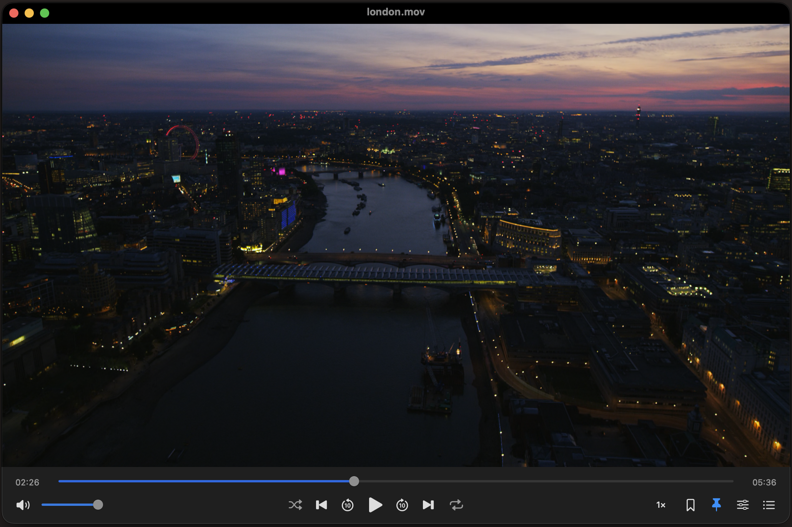

# Lola Player

**[Download Lola Player for Mac (.dmg)](https://github.com/mrkheradmand/LolaPlayer/releases/latest)** · Apple Silicon · macOS 27 or later

Open the DMG and drag Lola Player to Applications.

**First launch:** The app isn't notarized, so macOS may block the first launch: go to **System Settings → Privacy & Security** and click **Open Anyway**, or run this in Terminal after copying the app to Applications:

```sh
xattr -dr com.apple.quarantine "/Applications/Lola Player.app"
```

These instructions are also included in **Install Notes.txt** inside the DMG.

<p align="center">
  
</p>

*Screenshot from the app Lola Player.*

Lola Player is a native macOS video and audio player with **named bookmarks at any video timestamp** and **Float on Top that follows playback**. 

> **Save a moment. Name it. Find it again.** Bookmark the selected time in any playable video and give the bookmark a meaningful name. Lola keeps bookmarks from all your videos in a separate, searchable **Bookmarks** list—even after you open another file or restart the app. Search by bookmark name or filename, then click a bookmark to reopen the video and start playback at the exact saved time.

This is an independent implementation of the core free-player workflow. It is **not an exact visual or feature-complete clone**. 

| App information | Value |
| --- | --- |
| Version | 1.16.1, build 50 |
| Bundle identifier | `local.lolaplayer.app` |
| Current packaged architecture | Apple Silicon / arm64 |
| macOS requirement | macOS 27 or later |
| Interface | SwiftUI and AppKit |
| Playback engine | Bundled libmpv and FFmpeg dependencies |
| Signing | Ad hoc for local use; not notarized |
| Application | [dist/Lola Player.app](dist/Lola%20Player.app) |

## Contents

- [Lola Player](#lola-player)
  - [Contents](#contents)
  - [Getting started](#getting-started)
  - [Features](#features)
    - [Named video bookmarks: save, search, and replay exact moments](#named-video-bookmarks-save-search-and-replay-exact-moments)
    - [Playback-aware Float on Top](#playback-aware-float-on-top)
    - [Other playback controls](#other-playback-controls)
  - [Supported media](#supported-media)
  - [Using the player](#using-the-player)
    - [Media-only view](#media-only-view)
    - [Window dragging and timeline previews](#window-dragging-and-timeline-previews)
    - [Opening media and the library](#opening-media-and-the-library)
    - [Seeking, speed, looping, audio, and subtitles](#seeking-speed-looping-audio-and-subtitles)
    - [Settings and defaults](#settings-and-defaults)
    - [MacBook media buttons and Now Playing](#macbook-media-buttons-and-now-playing)
  - [Updates](#updates)
  - [Keyboard shortcuts](#keyboard-shortcuts)
  - [Importing from Elmedia](#importing-from-elmedia)
  - [Data, preferences, and backups](#data-preferences-and-backups)
    - [Export and restore](#export-and-restore)
    - [Local and network behavior](#local-and-network-behavior)
  - [Building from source](#building-from-source)
    - [Requirements](#requirements)
    - [Build the bundle](#build-the-bundle)
    - [Build details and environment variables](#build-details-and-environment-variables)
  - [Testing and verification](#testing-and-verification)
    - [Optional real-engine smoke test](#optional-real-engine-smoke-test)
  - [Project structure](#project-structure)
  - [Troubleshooting](#troubleshooting)
  - [Limitations and excluded features](#limitations-and-excluded-features)
  - [Dependencies and provenance](#dependencies-and-provenance)
  - [Automatic GitHub releases](#automatic-github-releases)
  - [Versions and release notes](#versions-and-release-notes)

## Getting started

1. [Open the latest release](https://github.com/mrkheradmand/LolaPlayer/releases/latest) and download **`LolaPlayer-<version>-macOS-arm64.dmg`** from Assets. Open the DMG and drag **Lola Player** to **Applications**. Eject the disk image and open the app from Applications. For a local source build, open **`dist/Lola Player.app`** in Finder.
2. Press **⌘O**, click **Open File…**, or drag media onto the player.
3. Press **Space** to pause or resume.
4. Press **⌘B** to save the current position.
5. Press **⇧⌘B** to see bookmarks from every file.
6. Click the **pin** button to enable floating during playback.

The packaged app includes its playback libraries. Running it does not require a separate IINA, mpv, FFmpeg, or Swift development installation. An Intel build is not supplied.

At launch, the welcome screen offers to resume the most recently opened file; playback does not start automatically until you open/select media. Closing the main window quits the app. If Lola's library is empty, supported Elmedia databases are imported automatically when available.

When no media file is open, the welcome screen displays a generated alpine-lake nature photo, with a subtle dark overlay for readable controls. It fills the video area as the window resizes and disappears when a media file is opened. The photo is bundled with the app and needs no network connection. Its source asset is [Resources/WelcomeNature.png](Resources/WelcomeNature.png); the built-in image-generation prompt is recorded in [Resources/WelcomeNature.prompt.txt](Resources/WelcomeNature.prompt.txt).

## Features

### Named video bookmarks: save, search, and replay exact moments

Save multiple moments in each video, name them for easy reference, and keep them together in the dedicated **Bookmarks** tab. Bookmarks remain attached to their source files across your library and history.

- **Save a selected time:** seek to the moment you want, then press **⌘B** or click the bookmark button.
- **Save with a name:** press **⌥B** to enter a name before saving, regardless of the bookmark-naming preference. Cancel leaves bookmarks unchanged.
- **Give it a name:** choose **… → Edit…** to enter a descriptive name, such as “Favorite scene” or “Chapter 2 explanation.” You can also adjust its saved time in seconds.
- **Keep every bookmark in one list:** open **View → Show All Bookmarks** or press **⇧⌘B** to browse bookmarks from all files, grouped by video.
- **Search your saved moments:** filter the list by bookmark name or filename.
- **Replay the exact moment:** click a bookmark to reopen its video and start playback at the saved time, even if another file is currently open.
- Delete individual bookmarks with their trash buttons.
- Remove every bookmark for one file using its file-row trash button or right-clicking the filename and choosing **Remove All Bookmarks for This File**.
- Import/export bookmarked records as JSON.

Selecting a bookmark starts playback even when automatic playback is disabled. Bookmarks survive app relaunch, clearing the playlist, and removing individual playlist entries. Times retain fractional-second precision internally, while displayed timestamps use whole seconds. Bookmark deletion currently has no Undo command.

File matching uses normalized paths, filesystem identity, and macOS URL bookmarks to help recognize renamed or moved files. If automatic resolution fails, right-click the file entry and choose **Relocate File…** to reconnect the original record without losing its bookmarks.

### Playback-aware Float on Top

Enable the pin button, **View → Float on Top**, or **⌥⌘T**.

| State | Behavior with Float on Top enabled |
| --- | --- |
| Playing loaded media | Floating window |
| Paused | Normal window level; preference remains enabled |
| Resumed | Floating returns automatically |
| Stopped or at end of file | Normal window level |
| Opening, buffering, or playback failure | Normal window level |
| Preference disabled | Normal window level |

The selected pin represents the saved preference, not necessarily the current window level. The status overlay is suppressed in media-only view. The status overlay appears when floating is enabled or its active state changes, then hides automatically after **two seconds**. It displays **Floating** when active and **Float on Top · paused** when suspended, including other inactive states such as end of file. Hiding the message does not change the floating preference or window level.

### Other playback controls

- Local video/audio playback; hardware decoding requested using libmpv's `auto-safe` mode.
- Direct media URLs and compatible network streams.
- Multiple-file opening, folder import, and M3U playlist loading/saving.
- Persistent playlist membership and Lola history.
- Seeking, ten-second skips, jump to time, frame stepping, and chapters.
- Playback speed from **0.25× to 4×**.
- Four repeat modes: off, one file, current folder, and whole library; shuffle and A–B looping.
- macOS Now Playing integration and previous/play-pause/next media-command handlers.
- Volume/mute, embedded track selection, external audio, and external subtitles.
- Audio/subtitle delay and subtitle size adjustments.
- Full screen, window size presets, and aspect-ratio selection.
- Native menus, keyboard shortcuts, tooltips, and labeled controls.

## Supported media

The app uses libmpv with FFmpeg rather than relying solely on macOS system codecs. File extensions are not a complete decoder inventory: playback also depends on codecs, file integrity, encryption, and the bundled runtime.

| Category | Documented formats or inputs |
| --- | --- |
| Video containers | MP4, MKV, MOV, AVI, WebM, M4V, WMV, FLV, MPEG/MPG, TS; 3GP/3G2, F4V, ASF, DIVX, M2TS/MTS/M2T, VOB/EVO, MXF, DV, Y4M, IVF, RM/RMVB, OGV/OGM, WTV, DAV, BIK/SMK, VVC/H266 |
| Audio files | MP3, M4A, FLAC, WAV, OGG, Opus, AAC; MKA, OGA, WEBA, AIF/AIFF/AIFC, CAF, AU/SND, APE, WV, MPC, TTA, TAK, SHN, AMR, SPX, WMA, AC3/EAC3, DTS/DTSHD, THD/MLP, DSF/DFF, RA |
| MIDI | Local MID/MIDI, synthesized using the macOS General MIDI component when available; no bundled SoundFont or encoded output |
| Newer codecs | VVC/H266 and ProRes RAW decoders are registered in the bundled FFmpeg 9.0.1 runtime, which also supplies newer AAC/USAC decoding. Specific files/profiles still need validation |
| Disc inputs | DVD/Blu-ray folders and ISO images are routed to the corresponding disc reader if compiled into the runtime. No interactive menus or decryption |
| Playlists | M3U and M3U8 |
| External subtitles | SRT, ASS, SSA, VTT, SUB |
| Network media | Direct playable HTTP/HTTPS addresses; RTSP and RTMP addresses are accepted and passed to the engine |

**Previously verified in the visible app:** H.264 video in MP4 with AC-3 audio, and H.264 video in MKV with Opus audio. The 1.1.0 decoder checks also successfully decoded synthetic AIFF, CAF, AU, WV, TTA, MKA, OGA, WEBA, WMA, AC3, EAC3, DTS, THD, MLP, 3GP, F4V, ASF, M2TS, MTS, VOB, IVF, Y4M, RM, and local HLS inputs through the bundled libmpv. This is not certification of every variant. Discs, network streams and specific VVC/xHE-AAC/ProRes RAW files have not all been verified. Native MIDI transport/bookmarks passed the real-app smoke checks; physical listening and every instrument/program variant are not certified. Tracker modules are intentionally excluded. Live streams may not support seeking or frame stepping.

**Playback runtime:** mpv **0.41.0** with FFmpeg **9.0.1**, bundled from the official IINA 1.5.0 package pinned in `Runtime/pinned.json`. Release builds download and verify that package; local builds can import it or select another compatible runtime. The app bundles its own libraries and does not depend on IINA remaining installed. Registered VVC and ProRes RAW decoders are confirmed; decoder presence does not certify every profile/file or hardware path. **Help → Playback Support…** reports the actual bundled versions and optional capabilities. A separate developer FFmpeg command is used only for generating test fixtures; its version depends on the local installation.

**Disc limits:** this runtime includes Blu-ray reading, but no native DVD reader. Unencrypted Blu-ray folder/image routing and numeric title selection are implemented, with real disc validation pending. DVD folders/images report the missing reader clearly; individual VOB files play. Interactive menus and decryption are excluded.

**Tracker modules:** MOD, XM, IT, S3M, MTM and UMX files are intentionally excluded. No libopenmpt dependency is bundled.

Input details:

- **Finder registrations are not playback restrictions.** Open… can pass other extensions to the engine. Some engine-readable formats are not registered document types.
- **Folder import is not recursive.** It scans regular, non-hidden files directly in the folder using the expanded media-extension allowlist. Recognized `VIDEO_TS` / `BDMV` structures are treated as one disc. ISO images opened directly prompt for DVD or Blu-ray; ordinary folders remain shallow scans. Finder registration is synchronized with `MediaFormats.fileExtensions` by `scripts/sync-formats.py`.
- **Local M3U/M3U8:** manifests containing HLS `#EXT-X-` tags go intact to libmpv, retaining segment, variant and key relationships. Ordinary playlists resolve relative/absolute paths and supported URLs; recursive cycles or nesting deeper than 16 playlists are rejected. Remote media/manifest URLs go directly to libmpv. Encrypted HLS requires accessible keys and engine support; DRM services are not supported.
- **SUB has several formats.** Binary/paired subtitle support depends on the engine and companion files.
- **Online media requires a playable address.** YouTube or other arbitrary video webpages are not extracted into streams.
- DRM-protected services and legacy Flash/SWF playback are not supported workflows.

## Using the player

### Media-only view

Press **2** to remove the window title bar, window buttons, and bottom playback controls from the visible layout. Only the media and seekable progress bar remain. The window fits the video’s display aspect ratio plus the 24-point progress strip, removing player-generated letterboxing from the old window shape. The media’s top edge stays at the same screen position when the title bar is hidden or restored, avoiding cumulative upward movement; portrait videos also narrow to fit the screen. Compact resizing preserves that aspect ratio. Press **1** to restore the saved window size, title bar, controls, and minimum-size constraints. The detached Library remains independently available in either mode. Full-screen windows keep their full-screen bounds; fitting/restoration applies when leaving full screen. Embedded black bars in a video file are not cropped. The mode starts off each launch and does not affect playback, floating, or bookmarks.

These unmodified shortcuts are ignored while editing text, in settings, or in a modal dialog. Both views are also available from the **View** menu and the video's right-click menu. Your chosen mode is saved as `mediaOnly` and restored on the next launch, independently of Remember Window Position and Size. The video's right-click menu ends with a separator and **Close**, which closes the player window using the normal window-close behavior. Opening Library preserves media-only mode and the player’s dimensions. The View menu shows 1 and 2 in its shortcut column, with no modifier key required; the shortcuts apply only to the main player window. The player handles Space and these view keys directly at window event dispatch, before the video/SwiftUI responder can consume them. Menu key equivalents use the same guarded handler. Events without an explicit source window use the current key window; events from Library or other auxiliary windows cannot change player mode. Clicking the video explicitly restores keyboard focus to the player. The macOS system menu bar remains available.

### Window dragging and timeline previews

Click and hold the media area, then move the pointer to drag the window, including in media-only view. Movement of at least four points starts a native window drag and suppresses play/pause for that gesture. A short click still toggles playback; a double-click toggles full screen. A successful video click briefly shows the resulting play/pause symbol in the media’s center. It appears immediately, holds for 100 ms, and fades with an opacity-only one-second strong ease-out curve (120 ms with Reduce Motion). The overlay works in normal, media-only, and full-screen layouts, does not affect layout or hit testing, and is hidden from accessibility to avoid duplicate control announcements. Repeated clicks replace previous feedback and cancel stale cleanup. Dragging, double-clicks, keyboard/menu commands, and transport-button actions do not trigger it. Loading another file and shutting down clear pending feedback. Single-click actions wait for the system double-click interval so a double-click does not also toggle playback. Dragging does not move a full-screen window, and controls keep their own click actions.

Hover over the progress bar or drag its playhead to see the selected timestamp and, for local video files, a thumbnail above the bar. This works in both normal and media-only layouts. Hovering does not seek or pause the main player. During dragging, the preview follows the scrub position independently of hover events; releasing the slider commits the seek. Audio, MIDI, network sources, local HLS/playlist manifests, and disc records show a timestamp without a thumbnail when a finite duration is available. If a local video preview cannot be decoded, the card shows an unavailable icon and the time.

Previews use persistent, silent libmpv decoders on background actors: one serves the latest interactive request, and another progressively warms up to 64 timeline samples using fast keyframe seeks. Files stay open between requests instead of being reloaded for each thumbnail. Frames fit 320×180 and share a bounded memory cache (up to 128 entries or 32 MiB). There is no artificial hover delay. Cached images are selected synchronously for hover and slider changes; a nearby cached frame stays visible while a precise half-second-bucket frame is decoded. An approximate frame is explicitly marked with its actual preview time. The selected pointer/scrub timestamp remains continuous. Rapid requests are coalesced so old pointer positions do not accumulate work or replace the current target. A cold or uncached exact frame still takes codec/storage-dependent decode time; warming and cached fallback avoid a blank wait once a preview is available. Frame waits remain bounded to three seconds. Changing or reloading the current media cancels old work, clears the cache, and releases the old decoder files. No thumbnail image files or app screenshots are saved. HDR color and unusual formats may differ from the main playback renderer.

### Opening media and the library

Use **File → Open…** for files, folders, or playlists. Opening multiple files adds them to the queue and selects the first according to the autoplay preference. Right-click the video for common playback, bookmark, floating, and opening actions.

| Library tab | Purpose |
| --- | --- |
| Playlist | Current queue, retained between normal launches |
| History | All file/URL records, ordered by most recent opening |
| Bookmarks | All bookmarked records, grouped by file |

Selecting a folder with the Library **+** button or **Open… (⌘O)** recursively adds supported media from all subfolders, skips non-media files, and opens the first media file. DVD/Blu-ray folder recognition retains its existing behavior.

Drop media files or folders anywhere in the **Playlist** view to append supported audio/video files, including files inside subfolders. Folder discovery runs in the background, skips hidden files and package contents, and does not follow directory symlinks during recursion. Overlapping/repeated drops do not duplicate existing playlist entries. Dropping files does not change the current playback or add unplayed files to History. The Playlist highlights while a file drop is over it. Drag an existing Playlist card over the upper or lower half of another card to show an insertion line before or after it, or drop in the space below the last card to append it. Reordering updates the saved playlist order without restarting playback; when search is active, the destination refers to that card in the full playlist. History and Bookmarks cards do not offer playlist reordering.

Playlist rows show green **Partially watched** or **Watched** text after the bookmark count after more than 60 seconds of cumulative active playback. Paused/buffering time and seeking do not count. Reaching the end after that threshold marks the file watched; replaying preserves completion. Status survives relaunch and playlist removal. Older library records start without a status.

During playback, a macOS display-sleep assertion and periodic user-activity declarations prevent idle system/display sleep and the screen saver, including audio and MIDI playback. Pausing, finishing, failure, or quitting releases them; buffering retains wake protection. Explicit Sleep remains available.

The **Library** is a separate, resizable native panel with Playlist, History, and Bookmarks navigation, grouped file cards, a highlighted current file, and timestamp badges for bookmarks. Each navigation button’s hit area covers its full width and padded height, including empty space around the icon and label. Open it with the player’s list button, **⌘L**, **⇧⌘H**, or **⇧⌘B**. Closing it leaves playback running and does not close the player.

On opening, Library prefers a 12-point gap to the player’s right. If space is unavailable, it checks the left, below, above, and other connected displays for an unobstructed position. If every available region is occupied by the player, it stays within screen bounds and overlaps at the upper right. You can move and resize it independently. In full screen it becomes an auxiliary floating panel at the right-center of the player’s screen, 24 points from the edge, and hides when the app is inactive. Entering or leaving full screen repositions the open panel. Opening Library does not shrink the player or reveal hidden playback controls.

**View → Remember Window Position and Size** is enabled by default. Normal window moves and resizes save the frame in UserDefaults (`playerWindowFrame`); the choice is saved as `rememberWindowGeometry`. On launch, a saved frame is restored to its connected display and constrained to usable screen bounds. If a display has disappeared, the frame moves onto an available display. Turning the option off clears the saved frame; the next launch uses the default centered window. Media-only mode saves the corresponding full-interface size and position; full-screen and intermediate transition frames do not replace the normal frame.

File-entry context menus offer **Play**, **Add to Playlist**, and, for local files, **Show in Finder** and **Relocate File…**. Each row has a trash button for its current tab:

| Tab | Row trash button | Footer action |
| --- | --- | --- |
| Playlist | Remove that entry from the queue | **Empty Playlist** clears the whole queue |
| History | Remove that file from History and Open Recent | **Empty History** clears all visible history |
| Bookmarks | Remove all bookmarks for that file | **Export…** |

The library search field releases keyboard focus when you click elsewhere in Library or another app window, including the video, controls, tabs, rows, and blank space. Its blue focus border disappears without clearing the search or consuming the click. Clicking inside the field or using keyboard navigation can focus it again.

Individual bookmarks also have their own trash buttons. Right-click a filename in Bookmarks to choose **Remove All Bookmarks for This File**. Empty actions apply to the entire list, even while a search is active.

These controls never delete media from disk. History removal preserves file records needed by bookmarks and the playlist; it persists after relaunch and is not undone by automatic position saves. Explicitly reopening a file adds it to History again. Removing/emptying the playlist leaves history and bookmarks intact. Removing all bookmarks leaves that file in History and the playlist, but removes its group from the Bookmarks tab.

**File → Open Recent** lists up to 30 files and links to full history. **File → Save Playlist…** writes an M3U list of locations; it does not copy media or export bookmarks.

### Seeking, speed, looping, audio, and subtitles

The normal bottom control area has only the timeline and transport/volume rows. The duplicate filename footer and its row height have been removed, giving that space back to the media area without changing the saved window frame. The filename remains in the title bar, Library, and Now Playing metadata.

Scroll vertically over the media area while the player window is active to adjust volume: physical wheel-up raises it and wheel-down lowers it, independent of the macOS natural-scrolling setting. Wheel events use 5-percentage-point steps; precise trackpad events use finer proportional changes, capped at 5 points per event. Volume stays within 0–100%. A brief percentage overlay appears in both normal and media-only layouts. Explicit mute remains enabled until you unmute. Horizontal-dominant scrolling and trackpad momentum are ignored. The handler lives on the video mouse surface, so Library, Settings, controls, and other windows keep their own scrolling; inactive player windows, Settings sheets, and modal dialogs cannot adjust player volume. Scrolling does not pause, seek, drag, or change keyboard focus.

- Drag the timeline, use the ten-second skip controls, or choose **Playback → Jump to Time…**. Times accept seconds or colon-separated values, such as `90`, `01:30`, or `01:02:30`.
- **⌘\** resets playback speed to **1×**. **⌥B** requires the focused player and is ignored during text editing, Settings, and modal dialogs; it does not respond while another app is active.
- The speed button toggles between 1× and 1.5×. Settings provides more speeds; keyboard shortcuts adjust by 0.1×.
- Click the **repeat button immediately after Next** to cycle: **Repeat Off → One File → Current Folder → Whole Library → Repeat Off**. Right-click it to select a mode directly. Playback → Repeat and Settings use the same modes.
- **Repeat Off:** stop at the end of the current file, even with other files queued or Shuffle enabled. The finished file stays selected; Play restarts it from the beginning. Manual Previous/Next still use the playlist without wrapping at its ends. **One File:** restart the current file when it ends; manual Previous/Next still use the playlist.
- **Current Folder:** cycle through regular, non-hidden media files in the current file’s immediate folder, sorted naturally by filename. Unopened sibling files are registered without appearing as played in History. Folder repeat requires a local media file; network URLs do not have a folder scope.
- **Whole Library:** cycle through all file/URL records known to Lola, including records outside the playlist or hidden from History, in natural filename order. Missing local files are skipped. This does not scan the entire Mac.
- Folder/library modes wrap from the last item to the first and from the first to the last. Automatic transitions and manual track changes start the selected file at zero. Shuffle chooses another available item within the active scope when possible. With Repeat Off it affects manual Previous/Next only; it never starts another file automatically. Toggle it with the **shuffle button immediately left of Previous**; blue means enabled. The button, Playback menu, and Settings share the same shuffle setting.
- For A–B looping, set A at the start and B at a later position. Clear/Cancel removes the loop. Opening another file clears its loop points.
- Choose chapters from **Playback → Chapters** when present. For disc records, **Playback → Choose Disc Title…** selects a DVD title (starting at 1) or Blu-ray playlist index (starting at 0). **Use Longest Disc Title** restores automatic selection. Disc bookmarks retain the selected title as well as the saved second. Frame stepping pauses playback; reverse stepping depends on the source/decoder.
- Select embedded tracks through **Audio → Audio Track** and **Subtitles → Subtitle Track**.
- Load external files through **Audio → Use External Audio…** or **Subtitles → Add Subtitles from File…**. You can also open/drop supported subtitles while media is loaded.
- Press **V** to toggle subtitles. Change their size through the Subtitles menu.
- Settings provides audio/subtitle delay. Positive values delay that stream; steppers use 0.1-second increments over −60 to +60 seconds.

The engine attempts to find matching external subtitles automatically. Opening subtitles alone does not choose a video for them.

### Settings and defaults

Open **Lola Player → Settings…**, press **⌘,**, or click the playback-settings button. The settings sheet uses a sidebar with **General**, **Playback**, and **Bookmarks** pages, grouped cards, descriptive switch rows with consistently right-aligned switches on every page, and a scrollable content area. Changes apply immediately; use **Done**, the close button, or Escape to dismiss it. General contains window and opening-media preferences; **Keep running when the player window closes** saves `keepRunningWhenWindowCloses` (off by default). When enabled, the red close button, ⌘W on the player, and the player context menu’s Close command pause playback, hide auxiliary windows, and retain the app in the Dock. Clicking the Dock icon restores the same player and loaded media without resuming automatically. Quit/⌘Q still flushes library changes and shuts down the playback engine. When disabled, closing the player quits as before. Playback contains speed, repeat, shuffle, synchronization, and A–B looping; Bookmarks contains naming and library actions. Update controls live in About.

| Setting | Initial default | Saved between launches? |
| --- | --- | --- |
| Float on Top while media is playing | Off | Yes |
| Keep running when the player window closes | Off | Yes |
| Remember playback position for every file | On | Yes |
| Play automatically when opening media | On | Yes |
| Ask for a name when adding a bookmark | Off | Yes |
| Automatically check for updates (About) | On | Yes |
| Remember Window Position and Size (View) | On | Yes |
| Playback speed | 1× | No |
| Repeat | Off | No |
| Shuffle | Off | No |
| Audio/subtitle delay | 0 seconds | No |

When position remembering is enabled, opening a file resumes its stored position. Reaching the end stores zero as its resume position. Positions are saved approximately every five seconds and on pause, file switching, and normal shutdown. Bookmark changes are saved immediately.

### MacBook media buttons and Now Playing

The app registers Apple's public `MPRemoteCommandCenter` handlers and publishes filename, duration, elapsed time, playback rate, and playing/paused/stopped state through `MPNowPlayingInfoCenter`.

| Physical media key | Player action |
| --- | --- |
| Previous (usually F7) | Previous item in the active playlist/folder/library scope |
| Play/pause (usually F8) | Toggle playback |
| Next (usually F9) | Next item in the active scope |

Start playing media in Lola so macOS can select it as the Now Playing app. Commands are disabled when no playable media is loaded; previous/next are disabled at non-repeating sequence boundaries. The app also handles separate system Play and Pause commands. It unregisters handlers and clears its metadata on shutdown.

If your function row is configured to use standard F1–F12 keys, use **Fn/Globe + F7/F8/F9** to send the media actions. On a Touch Bar Mac, use the corresponding media controls. macOS decides which media app receives these commands; another player or browser may own them until Lola starts playing again. No global key interception or Accessibility/Input Monitoring permission request is implemented.

Finder regression checks deliver synthetic keyboard events to Lola while Finder is actually frontmost. A separately launched Quick Look preview did not pause playback during investigation. Physical Space was not injected into Finder because event-posting access was unavailable; no new system permission was requested.

The integration is built against Apple's public framework. Verification of actual hardware presses is distinct from compiling/testing the application: the automated test suite does not simulate the MacBook's physical keyboard or certify routing when other media apps are active.

References: [MPRemoteCommandCenter](https://developer.apple.com/documentation/mediaplayer/mpremotecommandcenter), [MPNowPlayingInfoCenter](https://developer.apple.com/documentation/mediaplayer/mpnowplayinginfocenter).

## Updates

Automatic release checks are enabled by default and saved under the `automaticUpdateChecks` preference. They run at launch and every 24 hours while the app is running. Uncheck **Automatically check for updates** in **About Lola Player** to cancel a pending check and stop automatic requests. Checking manually from **About Lola Player → Check for Updates…** remains available when automatic checks are off. Opening About starts a fresh check only when automatic checking is enabled.

The checker uses GitHub’s [latest published release API](https://docs.github.com/en/rest/releases/releases#get-the-latest-release) at `https://api.github.com/repos/mrkheradmand/LolaPlayer/releases/latest`. It compares numeric `MAJOR.MINOR.PATCH` versions (optionally prefixed with `v`) against the running app’s bundle metadata, ignoring drafts, prereleases, and versions equal to or older than the installed app. It does not compare build numbers. Unsupported tags, invalid responses, connection failures, and rate limits appear as a check status in About without interrupting playback. Requests time out after 20 seconds; automatic failures retry on the next scheduled check or launch.

A newer release displays a persistent in-app notice, including in media-only view. **View Release** opens that release’s page in the browser; the app constructs links for this repository and does not automatically download, replace, or install anything. Dismissing a notice remembers that version in `dismissedUpdateVersion` and suppresses further automatic notices for it; a manual check can show it again. No system-notification permission is required. The notice stays in the player; Settings contains no update controls or notices.

**About Lola Player** displays `Version <version> (<build>)` followed by **Latest Version** after a successful check with no newer release, or a clickable **New version available!** link when a newer release exists. Its status updates live through the shared checker and remains available after the main notice is dismissed. Pending, unchecked, and failed checks have distinct labels and never claim the installed version is latest. **Check for Updates…** in About runs a manual check. The automatic-check checkbox is also in About; there is no separate Check for Updates app-menu command. The custom About panel retains the app icon, credits, and repository link and reads version/build from the running bundle. It closes when it loses key focus or the app becomes inactive, rather than using hide-on-deactivate restoration. Returning to the player or changing playback/window level cannot reopen the dismissed panel; choose About from the app menu to open it again.

Requests use an ephemeral session with no app-provided credentials or cookies. GitHub receives a normal HTTPS request and a User-Agent containing the app version; media files, library records, and bookmarks are not sent. Normal playback does not depend on successful update checks. Smoke-test launches suppress automatic checks.

## Keyboard shortcuts

Space, 1, and 2 require Lola to be the active, frontmost application and its player window to have key focus, with no text editing, Settings sheet, or modal dialog. The menu rejects keyboard equivalents while another app is frontmost, including source-less events or events incorrectly naming the player. Finder keeps Space for Quick Look. Other shortcuts apply when focus is not inside a text field or modal dialog. Dedicated system media commands remain independent and can still control background playback when macOS routes them to Lola. Help → Keyboard Shortcuts offers a shorter reference.

| Action | Shortcut |
| --- | --- |
| Show full interface | 1 |
| Media only with progress bar | 2 |
| Open files/folder/playlist | ⌘O |
| Open media URL | ⇧⌘O |
| Save playlist | ⌘S |
| Play / pause | Space |
| Stop and return to beginning | ⌘. |
| Jump to time | ⌘J |
| Back / forward 10 seconds | ← / → |
| Previous / next playlist item | ⌘← / ⌘→ |
| Volume up / down | ↑ / ↓ |
| Mute | ⌘M |
| Next / previous frame | E / ⇧E |
| Bookmark current position | ⌘B |
| Add named bookmark | ⌥B |
| Show all bookmarks | ⇧⌘B |
| Show history | ⇧⌘H |
| Show playlist | ⌘L |
| Toggle Float on Top preference | ⌥⌘T |
| Set loop starting / return point | ⌥⌘A / ⌥⌘B |
| Increase / decrease speed | ⌘] / ⌘[ |
| Reset speed to 1× | ⌘\ |
| Show / hide subtitles | V |
| Toggle full screen | ⌃⌘F |
| Settings | ⌘, |
| Minimize | ⌥⌘M |
| Hide app | ⌘H |
| Close window / quit | ⌘W / ⌘Q |

Press **1** or **2** without modifier keys while the player window is active. These view shortcuts are inactive while typing, in settings, or in a modal dialog. **1** restores the title bar, playback controls, and previously visible library; **2** fits the window around the media and seek bar; **1** also restores the previous window size.

Click the video to play/pause; double-click to toggle full screen; click, hold, and move to drag the window. Hover over the progress bar for a timestamp and local-video thumbnail.

## Importing from Elmedia

The importer supports the database schemas observed in Elmedia 8.24 at:

```text
~/Library/Application Support/Elmedia Player/
```

| Source database | Imported information |
| --- | --- |
| `Playlist.db` | Paths, durations, and saved positions from `playlist_items` |
| `TimeBookmarks.db` | Paths and archived bookmark times/names from `time_bookmarks` |
| `LastPosition.db` | Not directly imported; its hashed identifiers were not mapped to additional paths |

Import runs automatically if the normal Lola library is empty. Choose **File → Import Elmedia Library…** to repeat it. Original databases are opened read-only; archives are decoded with an explicit allowlist of Foundation classes.

Repeated imports skip bookmark times already present within 0.001 seconds. Existing Lola positions are preserved for known paths. Imported records appear in the library; a manual repeat import does not necessarily enqueue all records, so use **Add to Playlist** if needed.

The original installation check recovered **three files and six bookmarks**. That is a verification result, not a library-size limit. Other versions/layouts may require importer changes. Migration covers paths recoverable from the two supported databases, not every possible Elmedia history source.

## Data, preferences, and backups

| Data | Location |
| --- | --- |
| Records, history, positions, bookmarks | `~/Library/Application Support/LumenPlayer/library.json` |
| Preferences, player window frame, playlist UUIDs, and dismissed-update version | UserDefaults domain `local.lolaplayer.app` |
| Window frame | AppKit window-frame autosave |
| Build and test output | `.build/` |
| Built application | `dist/Lola Player.app` |

The bundle identifier is `local.lolaplayer.app`. On the first normal launch, preferences and playlist IDs from the previous `local.lumenplayer.app` domain are copied into the new domain without overwriting existing Lola preferences. The old preferences remain available. The `LumenPlayer` data directory, `LUMEN_*` environment-variable names, and saved window-frame key remain compatible, preserving bookmarks, history, playlist membership, settings, and window position.

Startup installs the menu and presents the window before loading the library in the background. Playlist restoration uses a set of record IDs. The hidden Library panel is created on demand, and playback-engine initialization is deferred until after the initial window is presented. Playback property changes are copied from libmpv events instead of synchronously querying properties from the UI timer. Automatic Elmedia import runs separately, batches disk writes, merges without replacing existing edits, and records a successful attempt even if no Elmedia data exists. Manual import remains available.

Library records contain UUIDs, media locations, filesystem identity, macOS URL-bookmark data, last-opened dates, positions, durations, and bookmark names/times. Writes use atomic replacement. The app coalesces immutable library snapshots on a serial background queue and flushes pending changes when quitting; save failures are reported. If decoding fails, the app preserves the original, reports the problem, and uses a separate `library-recovery-<UUID>.json` file.

### Export and restore

**Playback → Export Bookmarks…**, or **Export…** in Bookmarks, writes complete records for bookmarked files. It includes paths/URLs, resume metadata, and URL-bookmark data—not just titles and seconds. Import expects Lola's JSON format and restores media locations and bookmark times/names, skipping exact duplicate time/title pairs. It does not restore all exported record metadata, including filesystem identity, URL-bookmark data, resume positions, or per-bookmark disc-title selections. Use a full library backup to preserve those details. TXT/PBF exchange is not implemented.

For a complete backup, quit the app and copy `library.json`. You can export preferences separately:

```sh
defaults export local.lolaplayer.app LolaPlayer-preferences.plist
```

To restore, quit Lola, keep a copy of the current data, and put the backed-up library at its original location. Restore saved preferences while the app is closed with:

```sh
defaults import local.lolaplayer.app LolaPlayer-preferences.plist
```

A bookmark export omits unbookmarked history and playlist membership; a full library/preferences backup preserves both.

### Local and network behavior

The application code has no account, telemetry, cloud-sync, or purchasing integration. Optional automatic update checks contact GitHub as described under [Updates](#updates); updates are installed manually. Local playback and library operations do not require a server. Network playback connects to the supplied source through the engine. Media is referenced in place, rather than copied or uploaded by the library. Elmedia's original files/preferences are not modified.

## Building from source

### Requirements

- Swift **6.4.x** with a compatible macOS SDK (Xcode 27.0 or its Command Line Tools).
- Xcode or Command Line Tools providing `swift`, `xcrun`, `otool`, `install_name_tool`, and `codesign`.
- Python **3.11 or later** and zsh for packaging; GitHub workflows use Python 3.12.
- Apple Silicon for the supplied arm64 build and checks.
- A compatible `libmpv.2.dylib` and its dependent libraries, downloaded with `python3 scripts/fetch-runtime.py` or imported locally.
- GitHub CLI (`gh`) for publishing releases locally; it is not needed to build or run the app.
- A developer FFmpeg command for optional format-fixture generation; set `FFMPEG` to override its path.

No third-party Swift packages are downloaded. SQLite and UI/graphics frameworks come from the SDK. The documented system requirement is macOS 27 or later. The package deployment target and bundle minimum remain macOS 14, which does not establish tested support on older systems; building requires a compatible Swift toolchain and macOS SDK. The existing bundle was checked on the development Mac, not across every OS version.

### Build the bundle

For focused development, use `zsh scripts/check.sh metadata`, `core --filter Suite`, or `ui`. Use `release` for full CI checks and one app package. Runtime packaging reuses a content-verified cache when its source libraries, build helpers, and toolchain match; the final app is always signed and verified. Set `LOLA_RUNTIME_CACHE=0` for a fresh runtime inspection.

From the project root:

```sh
python3 scripts/fetch-runtime.py  # First build: download and stage the pinned runtime
zsh scripts/build-app.sh
```

Icon packaging preserves the original `Resources/LolaPlayerIcon.png` artwork and draws it with an 8% transparent inset on each side at every ICNS size, reducing its visual footprint in Dock, Finder, and About.

The script builds the release executable, creates the bundle, copies the metadata/icon, bundles playback dependencies, and signs the app ad hoc. Output:

```text
dist/Lola Player.app
```

Packaging searches in this order:

1. Existing file selected explicitly by `LUMEN_MPV_LIBRARY` (an invalid explicit path fails).
2. Workspace `Runtime/Frameworks/libmpv.2.dylib`, populated by `scripts/import-runtime.py`.
3. `/opt/homebrew/lib/libmpv.2.dylib`.
4. `/usr/local/lib/libmpv.2.dylib`.
5. `/Applications/IINA.app/Contents/Frameworks/libmpv.2.dylib`.

Example override:

```sh
LUMEN_MPV_LIBRARY="/absolute/path/to/libmpv.2.dylib" scripts/build-app.sh
```

The bundle uses the open-source runtime from IINA 1.5.0 and contains **44 playback libraries**, packaged for arm64. It does not need IINA to remain installed. Stage a compatible newer package with `python3 scripts/import-runtime.py "/path/to/IINA.app"` (or the official IINA 1.5.0 disk image). Runtime packages are imported without modifying the installed IINA app. The build probes actual versions/decoders and replaces libraries as a complete dependency closure, removing obsolete versions. Replacement runtimes must match the executable architecture and required APIs. Dependencies colocated with the runtime or referenced by absolute path are supported; arbitrary external `@rpath` layouts may require bundler changes.

Open `Package.swift` in Xcode for source inspection/debugging. A standalone development executable may need a library search path as well as `LUMEN_MPV_LIBRARY`; the packaged app provides its own `Contents/Frameworks` runpath.

### Build details and environment variables

- Caches are kept under `.build/` to avoid relying on writable global caches.
- Release debug information is disabled because the original managed environment blocked `dsymutil`; packaging does not produce a release dSYM.
- `--disable-sandbox` applies to SwiftPM's build sandbox; it does not change macOS security settings.
- [LolaPlayerIcon.png](Resources/LolaPlayerIcon.png) is the generated icon artwork: a flat mint-green play symbol and three sound-wave bars on a charcoal rounded-square tile with transparent exterior corners. It was created with the built-in image-generation tool; the [generation prompt](Resources/LolaPlayerIcon.prompt.txt) is preserved.
- Each build runs `scripts/generate-icon.swift` to resize this transparent master into `Resources/AppIcon.icns`, including standard and Retina representations from 16 to 1024 pixels, then copies it into the signed app bundle.
- `.build/`, `Runtime/Frameworks/`, and `dist/releases/` are ignored by Git. The packaged app under `dist/Lola Player.app` and fixtures under `Research/test-media/` are tracked. Other `Research/` files are ignored.

| Variable | Purpose |
| --- | --- |
| `LUMEN_MPV_LIBRARY` | Select runtime for packaging, or override the runtime loaded at app startup |
| `LUMEN_DATA_DIR` | Select a different directory for `library.json` during a normal launch |

`FFMPEG` selects the executable used by the optional format-playback test. `LUMEN_ALLOW_LEGACY_RUNTIME=1` permits a legacy playback runtime for development-only packaging, as described below.

The data-directory override does not isolate UserDefaults preferences or playlist IDs. Terminal environment variables do not automatically apply to a separately Finder-launched app.

## Testing and verification

Run:

```sh
zsh scripts/ci-checks.sh
```

This runs the toolchain guard, metadata and format-registration checks, Python tests, and Swift tests. For individual or optional checks:

```sh
zsh scripts/test.sh
python3 -m unittest discover -s Tests -p "test_*.py"
python3 scripts/test-format-playback.py  # Requires a built app and developer FFmpeg
```

The test script uses `.build/tests` and explicitly loads the toolchain's Swift Testing macro plugin to address the discovery issue encountered with the development toolchain.

Latest app validation (**1.9.7, build 38**, October 21, 2026) passed **49 tests in eleven Swift suites** and **102 real-app smoke checks with no skips**, using mpv 0.41.0 / FFmpeg 9.0.1. Startup checks cover menu readiness and deferred Library-panel creation; persistence tests cover coalesced saves, write-failure recovery, and import merging. All **16 Python helper tests** also passed during release preparation. Update-check tests cover numeric version comparison, stable-release filtering, malformed data, HTTP errors, and a simulated GitHub request. The public release endpoint was also reached successfully during 1.4.0 development. The app smoke run verified rejection of Space through menu/player dispatch with Finder frontmost, uninterrupted background playback, active-player Space pause/resume, Space text-entry protection, video-click pause/play confirmation, timed fade cleanup, replacement of pending feedback, no click animation from other playback commands, About status and panel creation, dismissal on key-focus loss/app deactivation, explicit reopening, actual player-click pausing without revealing cached About, mouse click/drag/double-click dispatch, in-memory MP4/MKV thumbnail timestamps and playback isolation, immediate cached previews, scrubbing previews without hover, media-only window fitting, unchanged video-surface screen position, twelve repeated view-mode toggles without window drift, restoration of the prior size/minimum, layout of all three Settings pages, About-only manual update access, title-bar removal and restoration, detached Library lifecycle and tab layouts without player resizing, View shortcut-column values, geometry preference and storage (including media-only normalization), preserved library visibility, repeat modes and queued playback, saved update preferences, notification dismissal, suppression of automatic networking in smoke mode, MP4/MKV playback, floating behavior, bookmarks, persistence, and recursive-playlist rejection. Direct player-window and application-level 1/2 key dispatch, source-less menu key events, keyboard focus after clicking playing video, auxiliary-window isolation, modifier/text-editing safeguards, and real menu key-equivalent protection for number entry passed in this run. New checks verified wheel-up/down volume changes on the actual video surface, 0–100% bounds, horizontal-scroll filtering, Settings/Library focus protection, mute preservation, and media-only percentage feedback. Native full-screen right-center Library placement and restoration to an independent panel also passed; no checks were skipped. Full-screen placement math remains covered by unit tests. Unit tests also cover multi-monitor placement, disconnected displays, saved-frame restoration, and full-screen placement math. That run used the development executable with the bundled playback libraries. Optional HLS and MIDI fixtures were not included in that run.

Version **1.6.1 (build 23)** added licensing and About text; license inclusion and app signing are also checked by the packaging workflow.

Historical validation for **1.1.0** additionally recorded **24 decoder/container/HLS checks** and a different smoke-test set. Those broader format checks were not rerun for 1.9.1.

Automated coverage includes:

- Bookmarks across files and reconstruction of the library from disk.
- Resume-position storage and repeat visits without duplicate records.
- Rename/symlink identity and explicit relocation without losing bookmarks.
- Independent bookmark editing/deletion per file.
- Preservation of an unreadable library file.
- History removal/emptying without losing bookmarks or queue records, persistence after relaunch, and re-adding a reopened file.
- Compatibility with older libraries that lack an explicit history-membership flag.
- Removing all bookmarks for one file while preserving its resume position and other files’ bookmarks.
- Disc-folder recognition, disc-title/bookmark persistence, HLS classification, expanded folder imports, and playlist path handling.
- Version/build consistency, newest-first changelog entries, preserved prior notes, and detection of stale README versions.
- Existing core history-cleanup behavior.
- Read-only, repeatable Elmedia import without duplicate bookmarks.
- Float preference/pause combinations and inactive playback states.
- About release-status labels, including explicit unchecked/checking/error states.
- Progress-bar time mapping, clamping, and unknown-duration handling.
- Update version comparisons, trusted release links, draft/prerelease filtering, invalid tags, malformed responses, HTTP failures, and request construction.
- All four repeat selections, forward/backward wrapping boundaries, empty/single-item scopes, stable natural library ordering, and folder discovery without changing History.

Earlier visible-app checks verified MP4/MKV playback, imported bookmark navigation across files, floating during playback, suspension on pause/end, a new five-second bookmark, and reopening it after relaunch. The final signature was verified with:

```sh
codesign --verify --deep --strict "dist/Lola Player.app"
```

### Optional real-engine smoke test

Provide an isolated directory containing `first.mp4` and `second.mkv`, both longer than ten seconds. Optional `hls/index.m3u8` and `score.mid` fixtures enable manifest and native-MIDI checks. The test reports passed checks and any unavailable-system-component skips separately:

```sh
"dist/Lola Player.app/Contents/MacOS/LolaPlayer" \
  --smoke-test /absolute/path/to/fixtures
```

The runner exercises the detached Library lifecycle and tab layouts, full-screen panel placement, window-geometry storage, actual View menu shortcuts, all three Settings page layouts, repeated view-mode changes without media/window drift, the About panel and live update-result labels, click/drag/double-click routing, MP4/MKV thumbnail extraction and playback isolation, hover cards in both layouts, end-of-file behavior for all four repeat modes, including Repeat Off with Shuffle and additional queued files, update-check preferences and dismissal without automatic networking, media-only shortcuts and window chrome, typing safeguards, decoding, actual window levels, pause/resume, file switching, bookmarks, persistence, and end-of-file behavior. It creates an isolated library subdirectory beside the fixtures, writes `smoke-result.json`, and exits. It temporarily changes float/autoplay/bookmark-prompt preferences and restores them on normal completion; its playlist is not persisted.

Launching the smoke runner requires a macOS graphical session and permission to launch the app. A successful automated app smoke run is recorded above; it does not replace visual inspection or certify every media format. `Research/test-media/` contains playback fixtures, not files required to use the app.

## Project structure

```text
Package.swift                    Package and target configuration
Sources/
  PlayerApp/
    Application.swift            Window/app lifecycle and native menus
    AboutWindow.swift            About panel with live release status and link
    PlayerModel.swift            Playback state, settings, persistence coordination
    PlayerModel+Updates.swift    Update scheduling, preferences, and notification state
    PlayerView.swift             Video and transport controls
    PlaybackClickFeedback.swift  Centered click-confirmation overlay and cancellable fade
    LibraryView.swift            Detached Library navigation, cards, search, and bookmark actions
    LibraryWindow.swift          Native panel lifecycle and full-screen placement
    SettingsView.swift           Sidebar settings pages and grouped preference controls
    PlayerMouseView.swift        Click, double-click, and native window dragging
    TimelinePreview.swift        Hover card, thumbnail scheduling, and memory cache
    SmokeTest.swift              Optional real-engine smoke runner
    SystemMediaControls.swift    macOS media commands and Now Playing metadata
  PlayerCore/
    Library.swift                Records, bookmarks, storage, floating policy
    ElmediaImport.swift          Read-only database/archive importer
    PlaybackOrder.swift          Repeat modes, ordering, and folder discovery
    MediaInput.swift             HLS/playlist parsing and disc-folder recognition
    UpdateChecker.swift          GitHub release requests and numeric version comparison
    UpdateAvailability.swift     Check-result states and About status labels
    ScrollVolume.swift           Wheel/trackpad normalization and gesture filtering
    TimelinePosition.swift       Hover/scrub mapping and progressive warmup positions
    WindowPlacement.swift        Library placement and safe saved-window restoration
    MediaWindowLayout.swift      Aspect-fitted compact-window geometry
  CMpv/
    CMpv.m                       Objective-C libmpv bridge and OpenGL renderer
    Thumbnail.m                  Separate in-memory libmpv thumbnail decoder
    include/CMpv.h               Swift-facing playback API
  CSQLite/                       System SQLite module map/header
Tests/PlayerCoreTests/            Swift Testing suites
Resources/                       Metadata, artwork, and installation notes
Runtime/                         Runtime download pin and setup documentation
scripts/                         Build, releases, runtime bundling, and checks
.github/workflows/               CI and tagged-release workflows
Research/test-media/             Tracked MP4/MKV playback fixtures
README.md                        Short guide for general users
README-technical.md              Detailed reference for power users
```

UI-facing Swift code runs on the main actor. The bridge dynamically loads libmpv, sends asynchronous commands, reads playback state, and renders on a dedicated serial OpenGL queue. Separating rendering from synchronous client reads follows libmpv's threading requirements. OpenGL is deprecated by Apple but used here for compatibility with the bundled runtime; Metal rendering is not implemented.

## Troubleshooting

| Symptom | What to check |
| --- | --- |
| Runtime missing/loading error | Rebuild; check `Contents/Frameworks/libmpv.2.dylib`, dependencies, architecture, and any runtime override. |
| Build cannot find libmpv | Set `LUMEN_MPV_LIBRARY` to an installed compatible runtime. |
| Packaging reports a missing dependency | Check the reported library path and runtime dependency layout. |
| Testing macro plugin cannot load | Confirm `xcrun --find swiftc` selects the intended toolchain and its `lib/swift/host/plugins/testing/libTestingMacros.dylib` exists. |
| File unavailable | Reconnect its volume, restore its path, or use **Relocate File…**. |
| Folder import omits a file | Scans are shallow and extension-filtered; open the file directly. |
| URL does not play | Use a direct media address; check access/connectivity. Opening times out after 20 seconds. |
| No audio/subtitles | Check mute/volume, track selection, subtitle visibility, and external-file compatibility. |
| Media keys control another app | Start playback in Lola and check macOS Now Playing. With standard function keys enabled, use Fn/Globe with F7/F8/F9. |
| Selected pin but no floating | Playback may be paused, loading, buffering, finished, or failed. The preference stays selected while suspended. |
| Missing bookmarks | Open All Bookmarks, clear search, and check the library directory. Clearing the playlist does not remove bookmarks. |
| Library cannot be decoded | Preserve the original and restore a backup or import a bookmark export; the error identifies the original location. |
| No Elmedia import results | Check the source directory and supported database schemas. |

## Limitations and excluded features

PRO features intentionally omitted:

- Casting/streaming to Apple TV, Chromecast, Smart TVs, or other devices.
- Picture-in-Picture.
- Video color/brightness/contrast tuning.
- Equalizer and advanced audio routing/passthrough.
- Screenshot sequences and capture tools.
- Activation, purchases, promotions, and upgrade dialogs.

Other differences from Elmedia:

- A new interface with a detached Library window rather than an exact visual reconstruction.
- No Flash/SWF, interactive DVD/Blu-ray menus, or disc decryption. Disc readers must be compiled into the runtime; recognized folders/images alone do not guarantee playback.
- No OpenSubtitles account/search integration or arbitrary webpage video extraction.
- No detached controls/playlists, controls auto-hide mode, or full Elmedia preference system.
- No playlist drag-reordering, custom shortcut editor, or bookmark Undo.
- JSON bookmark exchange only; no TXT/PBF interoperability.
- Folder scans are shallow. HLS, discs and MIDI instruments have the availability/verification limits described under Supported Media; tracker modules are excluded.
- Some playback settings are session-only.
- No cloud synchronization, automatic update installation, or installer. Release checking and notifications are available.

Validation does not certify every codec, service, hardware configuration, HDR path, or macOS version. The deployment target and broad engine support should not be read as evidence that every combination was tested.

## Dependencies and provenance

The application is newly written Swift and Objective-C. Playback uses open-source libmpv with dependent libraries, including FFmpeg and libass. REA inspected the original app's Mach-O metadata and a snapshot of its SQLite bookmark storage. The original local observations are in `Research/findings.md` and `Research/rea-evidence.json`; these ignored research files are not included in a repository checkout.

Primary technical references:

- [libmpv client API](https://github.com/mpv-player/mpv/blob/master/include/mpv/client.h)
- [libmpv rendering API](https://github.com/mpv-player/mpv/blob/master/include/mpv/render.h)
- [libmpv OpenGL integration](https://github.com/mpv-player/mpv/blob/master/include/mpv/render_gl.h)
- [mpv](https://mpv.io/), [FFmpeg](https://ffmpeg.org/), and [libass](https://github.com/libass/libass)

The generated app records runtime origin in `Contents/Resources/Runtime.txt`. Current packaging is for local use and does not assemble a complete third-party license/source distribution. Distribution would require handling the bundled components' applicable notices and source requirements. The original Lola Player application code and documentation are licensed under the [MIT License](LICENSE), copyright © 2026 J Kheradmand. This grant does not replace the licenses of bundled playback libraries or other third-party components. Packaging includes the app’s MIT license at `Contents/Resources/LICENSE`; About displays the copyright from `NSHumanReadableCopyright` and links to the license.

## Automatic GitHub releases

Ordinary branch pushes and pull requests run [Checks](.github/workflows/ci.yml): version/format consistency, Python release-tool tests, and Swift tests. They do not publish a release.

Pushing a version tag runs [Release](.github/workflows/release.yml) on GitHub's Apple Silicon [xcode-27 runner](https://github.com/actions/runner-images/blob/main/images/macos/xcode-27-arm64-Readme.md). Both workflows explicitly select Xcode 27.0 through `DEVELOPER_DIR` and check for Swift 6.4.x before compilation. This avoids the Swift 6.3.3 compiler crash encountered in `PlayerView.swift` on the macOS 26 runner. It validates the tag against `Resources/Info.plist`, README and the newest `versions.md` entry; runs the checks; imports a pinned playback runtime; builds and signs the app ad hoc; and creates the versioned DMG with its installation notes and checksum. Release notes combine every `versions.md` entry after the previous published stable release through the tagged version, grouped under Added, Modified, and Removed. Repeated bullet text is deduplicated (ignoring case, whitespace, and a trailing period); differently worded entries are preserved so changes are not silently omitted. Empty categories show None. Drafts, prereleases, and newer/equal tags are excluded when selecting the previous release; the highest older stable version is used. A first release includes all recorded entries, and a missing previous-release entry stops publication rather than generating incomplete notes.

Commit and push the completed changes before tagging that commit. Read the version from app metadata to avoid tagging an old version:

```sh
release_version=$(/usr/libexec/PlistBuddy -c 'Print :CFBundleShortVersionString' Resources/Info.plist)
git push origin HEAD
git tag -a "v$release_version" -m "Lola Player $release_version"
git push origin "v$release_version"
```

Use the actual version from `Resources/Info.plist` for each release. The workflow does not increment versions or edit commits. Only exact `vMAJOR.MINOR.PATCH` tags matching the newest version are accepted. Watch progress in the repository's **Actions** tab. GitHub Actions must be enabled and repository policy must allow the workflow's `contents: write` permission. Publishing uses the temporary `GITHUB_TOKEN`; no personal access token or Apple signing credentials are required.

The preparation and publishing scripts use the same cumulative-note generator, including when resuming a draft. You can preview notes offline with `python3 scripts/release-metadata.py vCURRENT --previous-tag vPREVIOUS`, substituting actual versions; output is written to `.build/release/release-notes.md`. This does not publish anything.

The workflow finds drafts through GitHub's paginated releases list and retains the numeric release ID when creating a draft. It uploads the DMG and `SHA256SUMS.txt`, verifies GitHub's reported asset sizes and SHA-256 digests, and publishes through that release ID. Draft verification does not use the published-release-only tag lookup. API failures report the endpoint and GitHub error message.

For transient upload or network failures, use **Re-run failed jobs**; retrying resumes the draft, while already-published releases are left untouched. Workflow or source fixes require committing the fix, updating the version, and pushing a new matching tag: rerunning an old tag still uses its original files. Old GitHub releases remain available, and the README's latest-release link follows the newest release automatically. DMGs use APFS to preserve signed bundle metadata; packaging mounts the finished image read-only and strictly verifies the app before replacing release assets. Local DMG builds archive previous images under `dist/releases/old/`; GitHub runners start fresh and do not retain that local archive.

The playback runtime download is fixed in [Runtime/pinned.json](Runtime/pinned.json) to the official [IINA 1.5.0 release](https://github.com/iina/iina/releases/tag/v1.5.0), with SHA-256 verification before mounting or importing. Only its playback libraries are bundled. You can fetch the same build input locally with `python3 scripts/fetch-runtime.py`. Updating the pin requires reviewing the new runtime, its checksum, and playback compatibility. Releases remain unnotarized; automation does not change first-launch approval requirements.

## Versions and release notes

The current app version is read from `Resources/Info.plist`; the About window uses that metadata. [versions.md](versions.md) records added, modified and removed features, newest first. Every completed app edit gets one version/build increment (minor for features, patch for fixes); rebuilding an unchanged change set does not create another version. The new version is reported for commit messages.

```sh
python3 scripts/version.py patch --modified "Describe the completed fix"
python3 scripts/version.py minor --added "Describe the new feature"
python3 scripts/version.py check
```

Use only the appropriate bump command for a given change set. It updates `Resources/Info.plist`, the version in `README.md`, and prepends release notes. Update the version in `README-technical.md` to match as well: the script currently checks and updates only the simple README. Keep behavior descriptions and shortcut tables current in both files. Packaging checks source metadata and the simple README, then embeds the release notes; rebuild the app before building a DMG so packaged metadata matches the source version. Added/Modified/Removed categories are always present.

Packaging stages and verifies the entire app before replacing `dist/Lola Player.app`; previous bundles are preserved under `.build/app-previous.*`. No user data is changed by packaging. `LUMEN_ALLOW_LEGACY_RUNTIME=1 scripts/build-app.sh` is an explicit development-only fallback for testing the UI and existing formats when a newer compatible runtime is unavailable; it records the actual legacy runtime and does not enable missing decoders. No encoder, converter or transcoding interface has been added.

MIDI uses Apple's system synthesizer through AVFAudio/AudioToolbox, not FluidSynth. It does not bundle proprietary sound banks or promise an entirely open-source synthesis stack. MIDI supports transport, tempo, volume/mute, A–B looping, bookmarks, repeat and Now Playing; frame stepping and video/subtitle adjustments do not apply. If the system instrument component is unavailable, opening MIDI reports an error rather than crashing. Earlier MIDI-specific smoke checks passed pause/resume, seek, bookmark and floating checks; the latest 1.9.1 smoke run did not include a MIDI fixture. A separate restricted-shell run also verified safe handling when the system component is unavailable. No physical-listening or exhaustive instrument test is claimed.
