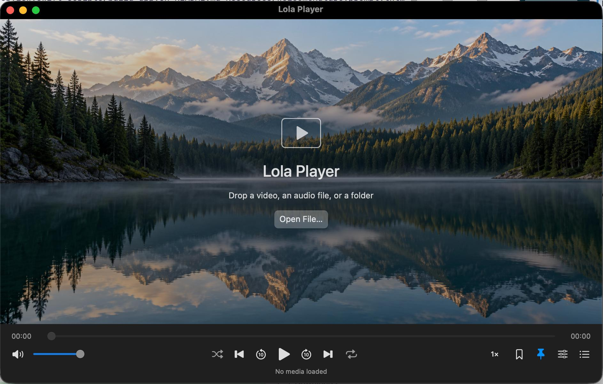

# Lola Player

**[Download Lola Player for Mac (.dmg)](https://github.com/mrkheradmand/LolaPlayer/releases/latest/download/LolaPlayer-arm64.dmg)** · Apple Silicon · macOS 14 or later

Open the DMG and drag Lola Player to Applications. The app is signed ad hoc and is not notarized; macOS may require approval in **System Settings → Privacy & Security** on first launch.



*Screenshot from the app Lola Player.*

Lola Player is a native macOS video and audio player with **named bookmarks at any video timestamp** and **Float on Top that follows playback**. It was built after inspecting the locally installed Elmedia Player 8.24 with REA and observing its interface.

> **Save a moment. Name it. Find it again.** Bookmark the selected time in any playable video and give the bookmark a meaningful name. Lola keeps bookmarks from all your videos in a separate, searchable **Bookmarks** list—even after you open another file or restart the app. Search by bookmark name or filename, then click a bookmark to reopen the video and start playback at the exact saved time.

This is an independent implementation of the core free-player workflow. It does not modify Elmedia or copy its executable or artwork. It is **not an exact visual or feature-complete clone**. PRO features are intentionally excluded; remaining differences are documented below.

| App information | Value |
| --- | --- |
| Version | 1.1.2, build 5 |
| Bundle identifier | `local.lolaplayer.app` |
| Current packaged architecture | Apple Silicon / arm64 |
| Minimum deployment target | macOS 14 |
| Interface | SwiftUI and AppKit |
| Playback engine | Bundled libmpv and FFmpeg dependencies |
| Signing | Ad hoc for local use; not notarized |
| Application | [dist/Lola Player.app](dist/Lola%20Player.app) |

## Contents

- [Lola Player](#lola-player)
  - [Contents](#contents)
  - [Getting started](#getting-started)
  - [Features](#features)
    - [Named video bookmarks: save, search, and replay exact moments](#named-video-bookmarks-save-search-and-replay-exact-moments)
    - [Playback-aware Float on Top](#playback-aware-float-on-top)
    - [Other playback controls](#other-playback-controls)
  - [Supported media](#supported-media)
  - [Using the player](#using-the-player)
    - [Opening media and the library](#opening-media-and-the-library)
    - [Seeking, speed, looping, audio, and subtitles](#seeking-speed-looping-audio-and-subtitles)
    - [Settings and defaults](#settings-and-defaults)
    - [MacBook media buttons and Now Playing](#macbook-media-buttons-and-now-playing)
  - [Keyboard shortcuts](#keyboard-shortcuts)
  - [Importing from Elmedia](#importing-from-elmedia)
  - [Data, preferences, and backups](#data-preferences-and-backups)
    - [Export and restore](#export-and-restore)
    - [Local and network behavior](#local-and-network-behavior)
  - [Building from source](#building-from-source)
    - [Requirements](#requirements)
    - [Build the bundle](#build-the-bundle)
    - [Build details and environment variables](#build-details-and-environment-variables)
  - [Testing and verification](#testing-and-verification)
    - [Optional real-engine smoke test](#optional-real-engine-smoke-test)
  - [Project structure](#project-structure)
  - [Troubleshooting](#troubleshooting)
  - [Limitations and excluded features](#limitations-and-excluded-features)
  - [Dependencies and provenance](#dependencies-and-provenance)
  - [Versions and release notes](#versions-and-release-notes)

## Getting started

1. [Download the DMG](https://github.com/mrkheradmand/LolaPlayer/releases/latest/download/LolaPlayer-arm64.dmg), open it, and drag **Lola Player** to **Applications**. Eject the disk image and open the app from Applications. For a local source build, open **`dist/Lola Player.app`** in Finder.
2. Press **⌘O**, click **Open File…**, or drag media onto the player.
3. Press **Space** to pause or resume.
4. Press **⌘B** to save the current position.
5. Press **⇧⌘B** to see bookmarks from every file.
6. Click the **pin** button to enable floating during playback.

The packaged app includes its playback libraries. Running it does not require a separate IINA, mpv, FFmpeg, or Swift development installation. An Intel build is not supplied.

At launch, the welcome screen offers to resume the most recently opened file; playback does not start automatically until you open/select media. Closing the main window quits the app. If Lola's library is empty, supported Elmedia databases are imported automatically when available.

When no media file is open, the welcome screen displays a generated alpine-lake nature photo, with a subtle dark overlay for readable controls. It fills the video area as the window resizes and disappears when a media file is opened. The photo is bundled with the app and needs no network connection. Its source asset is [Resources/WelcomeNature.png](Resources/WelcomeNature.png); the built-in image-generation prompt is recorded in [Resources/WelcomeNature.prompt.txt](Resources/WelcomeNature.prompt.txt).

## Features

### Named video bookmarks: save, search, and replay exact moments

Save multiple moments in each video, name them for easy reference, and keep them together in the dedicated **Bookmarks** tab. Bookmarks remain attached to their source files across your library and history.

- **Save a selected time:** seek to the moment you want, then press **⌘B** or click the bookmark button.
- **Give it a name:** choose **… → Edit…** to enter a descriptive name, such as “Favorite scene” or “Chapter 2 explanation.” You can also adjust its saved time in seconds.
- **Keep every bookmark in one list:** open **View → Show All Bookmarks** or press **⇧⌘B** to browse bookmarks from all files, grouped by video.
- **Search your saved moments:** filter the list by bookmark name or filename.
- **Replay the exact moment:** click a bookmark to reopen its video and start playback at the saved time, even if another file is currently open.
- Delete individual bookmarks with their trash buttons.
- Remove every bookmark for one file using its file-row trash button or right-clicking the filename and choosing **Remove All Bookmarks for This File**.
- Import/export bookmarked records as JSON.

Selecting a bookmark starts playback even when automatic playback is disabled. Bookmarks survive app relaunch, clearing the playlist, and removing individual playlist entries. Times retain fractional-second precision internally, while displayed timestamps use whole seconds. Bookmark deletion currently has no Undo command.

File matching uses normalized paths, filesystem identity, and macOS URL bookmarks to help recognize renamed or moved files. If automatic resolution fails, right-click the file entry and choose **Relocate File…** to reconnect the original record without losing its bookmarks.

### Playback-aware Float on Top

Enable the pin button, **View → Float on Top**, or **⌥⌘T**.

| State | Behavior with Float on Top enabled |
| --- | --- |
| Playing loaded media | Floating window |
| Paused | Normal window level; preference remains enabled |
| Resumed | Floating returns automatically |
| Stopped or at end of file | Normal window level |
| Opening, buffering, or playback failure | Normal window level |
| Preference disabled | Normal window level |

The selected pin represents the saved preference, not necessarily the current window level. The status overlay appears when floating is enabled or its active state changes, then hides automatically after **two seconds**. It displays **Floating** when active and **Float on Top · paused** when suspended, including other inactive states such as end of file. Hiding the message does not change the floating preference or window level.

### Other playback controls

- Local video/audio playback; hardware decoding requested using libmpv's `auto-safe` mode.
- Direct media URLs and compatible network streams.
- Multiple-file opening, folder import, and M3U playlist loading/saving.
- Persistent playlist membership and Lola history.
- Seeking, ten-second skips, jump to time, frame stepping, and chapters.
- Playback speed from **0.25× to 4×**.
- Four repeat modes: off, one file, current folder, and whole library; shuffle and A–B looping.
- macOS Now Playing integration and previous/play-pause/next media-command handlers.
- Volume/mute, embedded track selection, external audio, and external subtitles.
- Audio/subtitle delay and subtitle size adjustments.
- Full screen, window size presets, and aspect-ratio selection.
- Native menus, keyboard shortcuts, tooltips, and labeled controls.

## Supported media

The app uses libmpv with FFmpeg rather than relying solely on macOS system codecs. File extensions are not a complete decoder inventory: playback also depends on codecs, file integrity, encryption, and the bundled runtime.

| Category | Documented formats or inputs |
| --- | --- |
| Video containers | MP4, MKV, MOV, AVI, WebM, M4V, WMV, FLV, MPEG/MPG, TS; 3GP/3G2, F4V, ASF, DIVX, M2TS/MTS/M2T, VOB/EVO, MXF, DV, Y4M, IVF, RM/RMVB, OGV/OGM, WTV, DAV, BIK/SMK |
| Audio files | MP3, M4A, FLAC, WAV, OGG, Opus, AAC; MKA, OGA, WEBA, AIF/AIFF/AIFC, CAF, AU/SND, APE, WV, MPC, TTA, TAK, SHN, AMR, SPX, WMA, AC3/EAC3, DTS/DTSHD, THD/MLP, DSF/DFF, RA |
| MIDI | Local MID/MIDI, synthesized using the macOS General MIDI component when available; no bundled SoundFont or encoded output |
| Newer codecs | VVC/H266 and ProRes RAW decoders are registered in the bundled FFmpeg 9.0.1 runtime, which also supplies newer AAC/USAC decoding. Specific files/profiles still need validation |
| Disc inputs | DVD/Blu-ray folders and ISO images are routed to the corresponding disc reader if compiled into the runtime. No interactive menus or decryption |
| Playlists | M3U and M3U8 |
| External subtitles | SRT, ASS, SSA, VTT, SUB |
| Network media | Direct playable HTTP/HTTPS addresses; RTSP and RTMP addresses are accepted and passed to the engine |

**Previously verified in the visible app:** H.264 video in MP4 with AC-3 audio, and H.264 video in MKV with Opus audio. The 1.1.0 decoder checks also successfully decoded synthetic AIFF, CAF, AU, WV, TTA, MKA, OGA, WEBA, WMA, AC3, EAC3, DTS, THD, MLP, 3GP, F4V, ASF, M2TS, MTS, VOB, IVF, Y4M, RM, and local HLS inputs through the bundled libmpv. This is not certification of every variant. Discs, network streams and specific VVC/xHE-AAC/ProRes RAW files have not all been verified. Native MIDI transport/bookmarks passed the real-app smoke checks; physical listening and every instrument/program variant are not certified. Tracker modules are intentionally excluded. Live streams may not support seeking or frame stepping.

**Playback runtime:** mpv **0.41.0** with FFmpeg **9.0.1**, imported from the official IINA 1.5.0 package supplied locally. The app bundles its own libraries and does not depend on IINA remaining installed. Registered VVC and ProRes RAW decoders are confirmed; decoder presence does not certify every profile/file or hardware path. **Help → Playback Support…** reports the actual bundled versions and optional capabilities. The separate developer FFmpeg 9.0.2 command is used only for generating test fixtures.

**Disc limits:** this runtime includes Blu-ray reading, but no native DVD reader. Unencrypted Blu-ray folder/image routing and numeric title selection are implemented, with real disc validation pending. DVD folders/images report the missing reader clearly; individual VOB files play. Interactive menus and decryption are excluded.

**Tracker modules:** MOD, XM, IT, S3M, MTM and UMX support was removed from this update at the user’s request. No libopenmpt dependency is bundled.

Input details:

- **Finder registrations are not playback restrictions.** Open… can pass other extensions to the engine. Some engine-readable formats are not registered document types.
- **Folder import is not recursive.** It scans regular, non-hidden files directly in the folder using the expanded media-extension allowlist. Recognized `VIDEO_TS` / `BDMV` structures are treated as one disc. ISO images opened directly prompt for DVD or Blu-ray; ordinary folders remain shallow scans. Finder registration is synchronized with `MediaFormats.fileExtensions` by `scripts/sync-formats.py`.
- **Local M3U/M3U8:** manifests containing HLS `#EXT-X-` tags go intact to libmpv, retaining segment, variant and key relationships. Ordinary playlists resolve relative/absolute paths and supported URLs; recursive cycles or nesting deeper than 16 playlists are rejected. Remote media/manifest URLs go directly to libmpv. Encrypted HLS requires accessible keys and engine support; DRM services are not supported.
- **SUB has several formats.** Binary/paired subtitle support depends on the engine and companion files.
- **Online media requires a playable address.** YouTube or other arbitrary video webpages are not extracted into streams.
- DRM-protected services and legacy Flash/SWF playback are not supported workflows.

## Using the player

### Opening media and the library

Use **File → Open…** for files, folders, or playlists. Opening multiple files adds them to the queue and selects the first according to the autoplay preference. Right-click the video for common playback, bookmark, floating, and opening actions.

| Sidebar tab | Purpose |
| --- | --- |
| Playlist | Current queue, retained between normal launches |
| History | All file/URL records, ordered by most recent opening |
| Bookmarks | All bookmarked records, grouped by file |

File-entry context menus offer **Play**, **Add to Playlist**, and, for local files, **Show in Finder** and **Relocate File…**. Each row has a trash button for its current tab:

| Tab | Row trash button | Footer action |
| --- | --- | --- |
| Playlist | Remove that entry from the queue | **Empty Playlist** clears the whole queue |
| History | Remove that file from History and Open Recent | **Empty History** clears all visible history |
| Bookmarks | Remove all bookmarks for that file | **Export…** |

Individual bookmarks also have their own trash buttons. Right-click a filename in Bookmarks to choose **Remove All Bookmarks for This File**. Empty actions apply to the entire list, even while a search is active.

These controls never delete media from disk. History removal preserves file records needed by bookmarks and the playlist; it persists after relaunch and is not undone by automatic position saves. Explicitly reopening a file adds it to History again. Removing/emptying the playlist leaves history and bookmarks intact. Removing all bookmarks leaves that file in History and the playlist, but removes its group from the Bookmarks tab.

**File → Open Recent** lists up to 30 files and links to full history. **File → Save Playlist…** writes an M3U list of locations; it does not copy media or export bookmarks.

### Seeking, speed, looping, audio, and subtitles

- Drag the timeline, use the ten-second skip controls, or choose **Playback → Jump to Time…**. Times accept seconds or colon-separated values, such as `90`, `01:30`, or `01:02:30`.
- The speed button toggles between 1× and 1.5×. Settings provides more speeds; keyboard shortcuts adjust by 0.1×.
- Click the **repeat button immediately after Next** to cycle: **Repeat Off → One File → Current Folder → Whole Library → Repeat Off**. Right-click it to select a mode directly. Playback → Repeat and Settings use the same modes.
- **Repeat Off:** continue through the playlist without wrapping at its ends. **One File:** restart the current file when it ends; manual Previous/Next still use the playlist.
- **Current Folder:** cycle through regular, non-hidden media files in the current file’s immediate folder, sorted naturally by filename. Unopened sibling files are registered without appearing as played in History. Folder repeat requires a local media file; network URLs do not have a folder scope.
- **Whole Library:** cycle through all file/URL records known to Lola, including records outside the playlist or hidden from History, in natural filename order. Missing local files are skipped. This does not scan the entire Mac.
- Folder/library modes wrap from the last item to the first and from the first to the last. Automatic transitions and manual track changes start the selected file at zero. Shuffle chooses another available item within the active scope when possible. Toggle it with the **shuffle button immediately left of Previous**; blue means enabled. The button, Playback menu, and Settings share the same shuffle setting.
- For A–B looping, set A at the start and B at a later position. Clear/Cancel removes the loop. Opening another file clears its loop points.
- Choose chapters from **Playback → Chapters** when present. For disc records, **Playback → Choose Disc Title…** selects a DVD title (starting at 1) or Blu-ray playlist index (starting at 0). **Use Longest Disc Title** restores automatic selection. Disc bookmarks retain the selected title as well as the saved second. Frame stepping pauses playback; reverse stepping depends on the source/decoder.
- Select embedded tracks through **Audio → Audio Track** and **Subtitles → Subtitle Track**.
- Load external files through **Audio → Use External Audio…** or **Subtitles → Add Subtitles from File…**. You can also open/drop supported subtitles while media is loaded.
- Press **V** to toggle subtitles. Change their size through the Subtitles menu.
- Settings provides audio/subtitle delay. Positive values delay that stream; steppers use 0.1-second increments over −60 to +60 seconds.

The engine attempts to find matching external subtitles automatically. Opening subtitles alone does not choose a video for them.

### Settings and defaults

Open **Lola Player → Settings…**, press **⌘,**, or click the playback-settings button.

| Setting | Initial default | Saved between launches? |
| --- | --- | --- |
| Float on Top while media is playing | Off | Yes |
| Remember playback position for every file | On | Yes |
| Play automatically when opening media | On | Yes |
| Ask for a name when adding a bookmark | Off | Yes |
| Playback speed | 1× | No |
| Repeat | Off | No |
| Shuffle | Off | No |
| Audio/subtitle delay | 0 seconds | No |

When position remembering is enabled, opening a file resumes its stored position. Reaching the end stores zero as its resume position. Positions are saved approximately every five seconds and on pause, file switching, and normal shutdown. Bookmark changes are saved immediately.

### MacBook media buttons and Now Playing

The app registers Apple's public `MPRemoteCommandCenter` handlers and publishes filename, duration, elapsed time, playback rate, and playing/paused/stopped state through `MPNowPlayingInfoCenter`.

| Physical media key | Player action |
| --- | --- |
| Previous (usually F7) | Previous item in the active playlist/folder/library scope |
| Play/pause (usually F8) | Toggle playback |
| Next (usually F9) | Next item in the active scope |

Start playing media in Lola so macOS can select it as the Now Playing app. Commands are disabled when no playable media is loaded; previous/next are disabled at non-repeating sequence boundaries. The app also handles separate system Play and Pause commands. It unregisters handlers and clears its metadata on shutdown.

If your function row is configured to use standard F1–F12 keys, use **Fn/Globe + F7/F8/F9** to send the media actions. On a Touch Bar Mac, use the corresponding media controls. macOS decides which media app receives these commands; another player or browser may own them until Lola starts playing again. No global key interception or Accessibility/Input Monitoring permission request is implemented.

The integration is built against Apple's public framework. Verification of actual hardware presses is distinct from compiling/testing the application: the automated test suite does not simulate the MacBook's physical keyboard or certify routing when other media apps are active.

References: [MPRemoteCommandCenter](https://developer.apple.com/documentation/mediaplayer/mpremotecommandcenter), [MPNowPlayingInfoCenter](https://developer.apple.com/documentation/mediaplayer/mpnowplayinginfocenter).

## Keyboard shortcuts

Shortcuts apply when focus is not inside a text field or modal dialog. Help → Keyboard Shortcuts offers a shorter reference.

| Action | Shortcut |
| --- | --- |
| Open files/folder/playlist | ⌘O |
| Open media URL | ⇧⌘O |
| Save playlist | ⌘S |
| Play / pause | Space |
| Stop and return to beginning | ⌘. |
| Jump to time | ⌘J |
| Back / forward 10 seconds | ← / → |
| Previous / next playlist item | ⌘← / ⌘→ |
| Volume up / down | ↑ / ↓ |
| Mute | ⌘M |
| Next / previous frame | E / ⇧E |
| Bookmark current position | ⌘B |
| Show all bookmarks | ⇧⌘B |
| Show history | ⇧⌘H |
| Show playlist | ⌘L |
| Toggle Float on Top preference | ⌥⌘T |
| Set loop starting / return point | ⌥⌘A / ⌥⌘B |
| Increase / decrease speed | ⌘] / ⌘[ |
| Reset speed | ⌘\ |
| Show / hide subtitles | V |
| Toggle full screen | ⌃⌘F |
| Settings | ⌘, |
| Minimize | ⌥⌘M |
| Hide app | ⌘H |
| Close window / quit | ⌘W / ⌘Q |

Click the video to play/pause; double-click to toggle full screen.

## Importing from Elmedia

The importer supports the database schemas observed in Elmedia 8.24 at:

```text
~/Library/Application Support/Elmedia Player/
```

| Source database | Imported information |
| --- | --- |
| `Playlist.db` | Paths, durations, and saved positions from `playlist_items` |
| `TimeBookmarks.db` | Paths and archived bookmark times/names from `time_bookmarks` |
| `LastPosition.db` | Not directly imported; its hashed identifiers were not mapped to additional paths |

Import runs automatically if the normal Lola library is empty. Choose **File → Import Elmedia Library…** to repeat it. Original databases are opened read-only; archives are decoded with an explicit allowlist of Foundation classes.

Repeated imports skip bookmark times already present within 0.001 seconds. Existing Lola positions are preserved for known paths. Imported records appear in the library; a manual repeat import does not necessarily enqueue all records, so use **Add to Playlist** if needed.

The original installation check recovered **three files and six bookmarks**. That is a verification result, not a library-size limit. Other versions/layouts may require importer changes. Migration covers paths recoverable from the two supported databases, not every possible Elmedia history source.

## Data, preferences, and backups

| Data | Location |
| --- | --- |
| Records, history, positions, bookmarks | `~/Library/Application Support/LumenPlayer/library.json` |
| Preferences and playlist UUIDs | UserDefaults domain `local.lolaplayer.app` |
| Window frame | AppKit window-frame autosave |
| Build and test output | `.build/` |
| Built application | `dist/Lola Player.app` |

The bundle identifier is `local.lolaplayer.app`. On the first normal launch, preferences and playlist IDs from the previous `local.lumenplayer.app` domain are copied into the new domain without overwriting existing Lola preferences. The old preferences remain available. The `LumenPlayer` data directory, `LUMEN_*` environment-variable names, and saved window-frame key remain compatible, preserving bookmarks, history, playlist membership, settings, and window position.

Library records contain UUIDs, media locations, filesystem identity, macOS URL-bookmark data, last-opened dates, positions, durations, and bookmark names/times. Writes use atomic replacement. If decoding fails, the app preserves the original, reports the problem, and uses a separate `library-recovery-<UUID>.json` file.

### Export and restore

**Playback → Export Bookmarks…**, or **Export…** in Bookmarks, writes complete records for bookmarked files. It includes paths/URLs, resume metadata, and URL-bookmark data—not just titles and seconds. Import expects Lola's JSON format and skips exact duplicate time/title pairs. TXT/PBF exchange is not implemented.

For a complete backup, quit the app and copy `library.json`. You can export preferences separately:

```sh
defaults export local.lolaplayer.app LolaPlayer-preferences.plist
```

To restore, quit Lola, keep a copy of the current data, and put the backed-up library at its original location. Restore saved preferences while the app is closed with:

```sh
defaults import local.lolaplayer.app LolaPlayer-preferences.plist
```

A bookmark export omits unbookmarked history and playlist membership; a full library/preferences backup preserves both.

### Local and network behavior

The application code has no account, telemetry, cloud-sync, purchasing, or automatic-update integration. Local playback and library operations do not require a server. Network playback connects to the supplied source through the engine. Media is referenced in place, rather than copied or uploaded by the library. Elmedia's original files/preferences are not modified.

## Building from source

### Requirements

- Swift **6.2 or later** with a compatible macOS SDK.
- Xcode or Command Line Tools providing `swift`, `xcrun`, `otool`, `install_name_tool`, and `codesign`.
- Python 3 and zsh for packaging.
- A compatible installed `libmpv.2.dylib` and its dependent libraries.

No third-party Swift packages are downloaded. SQLite and UI/graphics frameworks come from the SDK. The macOS 14 deployment target does not imply the development toolchain runs on every macOS 14 machine. The existing bundle was checked on the development Mac, not across every OS version.

### Build the bundle

From the project root:

```sh
scripts/build-app.sh
```

The script builds the release executable, creates the bundle, copies the metadata/icon, bundles playback dependencies, and signs the app ad hoc. Output:

```text
dist/Lola Player.app
```

Packaging searches in this order:

1. Existing file selected explicitly by `LUMEN_MPV_LIBRARY` (an invalid explicit path fails).
2. Workspace `Runtime/Frameworks/libmpv.2.dylib`, populated by `scripts/import-runtime.py`.
3. `/opt/homebrew/lib/libmpv.2.dylib`.
4. `/usr/local/lib/libmpv.2.dylib`.
5. `/Applications/IINA.app/Contents/Frameworks/libmpv.2.dylib`.

Example override:

```sh
LUMEN_MPV_LIBRARY="/absolute/path/to/libmpv.2.dylib" scripts/build-app.sh
```

The bundle uses the open-source runtime from IINA 1.5.0 and contains **44 playback libraries**, packaged for arm64. It does not need IINA to remain installed. Stage a compatible newer package with `python3 scripts/import-runtime.py "/path/to/IINA.app"` (or the official IINA 1.5.0 disk image). Runtime packages are imported without modifying the installed IINA app. The build probes actual versions/decoders and replaces libraries as a complete dependency closure, removing obsolete versions. Replacement runtimes must match the executable architecture and required APIs. Dependencies colocated with the runtime or referenced by absolute path are supported; arbitrary external `@rpath` layouts may require bundler changes.

Open `Package.swift` in Xcode for source inspection/debugging. A standalone development executable may need a library search path as well as `LUMEN_MPV_LIBRARY`; the packaged app provides its own `Contents/Frameworks` runpath.

### Build details and environment variables

- Caches are kept under `.build/` to avoid relying on writable global caches.
- Release debug information is disabled because the original managed environment blocked `dsymutil`; packaging does not produce a release dSYM.
- `--disable-sandbox` applies to SwiftPM's build sandbox; it does not change macOS security settings.
- [LolaPlayerIcon.png](Resources/LolaPlayerIcon.png) is the generated icon artwork: a luminous play symbol and cyan/violet playback ring on an indigo tile. It was created with the built-in image-generation tool; the [generation prompt](Resources/LolaPlayerIcon.prompt.txt) is preserved.
- Each build runs `scripts/generate-icon.swift` to resize this transparent master into `Resources/AppIcon.icns`, including standard and Retina representations from 16 to 1024 pixels, then copies it into the signed app bundle.
- `.build/`, `dist/`, and generated research fixtures are ignored by `.gitignore`.

| Variable | Purpose |
| --- | --- |
| `LUMEN_MPV_LIBRARY` | Select runtime for packaging, or override the runtime loaded at app startup |
| `LUMEN_DATA_DIR` | Select a different directory for `library.json` during a normal launch |

The data-directory override does not isolate UserDefaults preferences or playlist IDs. Terminal environment variables do not automatically apply to a separately Finder-launched app.

## Testing and verification

Run:

```sh
scripts/test.sh
python3 -m unittest discover -s Tests -p "test_*.py"
python3 scripts/test-format-playback.py
```

The test script uses `.build/tests` and explicitly loads the toolchain's Swift Testing macro plugin to address the discovery issue encountered with the development toolchain.

The 1.1.0 run passed **22 tests in four Swift suites**, one Python version-sync regression test, **24 decoder/container/HLS checks**, and **15 real-app smoke checks** on mpv 0.41.0 / FFmpeg 9.0.1. Coverage includes:

- Bookmarks across files and reconstruction of the library from disk.
- Resume-position storage and repeat visits without duplicate records.
- Rename/symlink identity and explicit relocation without losing bookmarks.
- Independent bookmark editing/deletion per file.
- Preservation of an unreadable library file.
- History removal/emptying without losing bookmarks or queue records, persistence after relaunch, and re-adding a reopened file.
- Compatibility with older libraries that lack an explicit history-membership flag.
- Removing all bookmarks for one file while preserving its resume position and other files’ bookmarks.
- Disc-folder recognition, disc-title/bookmark persistence, HLS classification, expanded folder imports, and playlist path handling.
- Version/build consistency, newest-first changelog entries, preserved prior notes, and detection of stale README versions.
- Existing core history-cleanup behavior.
- Read-only, repeatable Elmedia import without duplicate bookmarks.
- Float preference/pause combinations and inactive playback states.
- All four repeat selections, forward/backward wrapping boundaries, empty/single-item scopes, stable natural library ordering, and folder discovery without changing History.

Visible-app checks verified MP4/MKV playback, imported bookmark navigation across files, floating during playback, suspension on pause/end, a new five-second bookmark, and reopening it after relaunch. The final signature was verified with:

```sh
codesign --verify --deep --strict "dist/Lola Player.app"
```

### Optional real-engine smoke test

Provide an isolated directory containing `first.mp4` and `second.mkv`, both longer than ten seconds. Optional `hls/index.m3u8` and `score.mid` fixtures enable manifest and native-MIDI checks. The test reports passed checks and any unavailable-system-component skips separately:

```sh
"dist/Lola Player.app/Contents/MacOS/LolaPlayer" \
  --smoke-test /absolute/path/to/fixtures
```

The runner exercises decoding, actual window levels, pause/resume, file switching, bookmarks, persistence, and end-of-file behavior. It creates an isolated library subdirectory beside the fixtures, writes `smoke-result.json`, and exits. It temporarily changes float/autoplay/bookmark-prompt preferences and restores them on normal completion; its playlist is not persisted.

The command-line runner could not launch in the original agent's restricted shell, so no successful automated GUI smoke run is claimed. Visible checks were performed instead. Generated `Research/test-media/` files are local fixtures, not requirements for using the app.

## Project structure

```text
Package.swift                    Package and target configuration
Sources/
  PlayerApp/
    Application.swift            Window/app lifecycle and native menus
    PlayerModel.swift            Playback state, settings, persistence coordination
    PlayerView.swift             Video, transport controls, library, settings UI
    SmokeTest.swift              Optional real-engine smoke runner
    SystemMediaControls.swift    macOS media commands and Now Playing metadata
  PlayerCore/
    Library.swift                Records, bookmarks, storage, floating policy
    ElmediaImport.swift          Read-only database/archive importer
    PlaybackOrder.swift          Repeat modes, ordering, and folder discovery
  CMpv/
    CMpv.m                       Objective-C libmpv bridge and OpenGL renderer
    include/CMpv.h               Swift-facing playback API
  CSQLite/                       System SQLite module map/header
Tests/PlayerCoreTests/            Swift Testing suites
Resources/                       Metadata and app icon
scripts/                         Build, runtime bundling, tests, icon source
Research/                        REA findings, evidence, reference resources
```

UI-facing Swift code runs on the main actor. The bridge dynamically loads libmpv, sends asynchronous commands, reads playback state, and renders on a dedicated serial OpenGL queue. Separating rendering from synchronous client reads follows libmpv's threading requirements. OpenGL is deprecated by Apple but used here for compatibility with the bundled runtime; Metal rendering is not implemented.

## Troubleshooting

| Symptom | What to check |
| --- | --- |
| Runtime missing/loading error | Rebuild; check `Contents/Frameworks/libmpv.2.dylib`, dependencies, architecture, and any runtime override. |
| Build cannot find libmpv | Set `LUMEN_MPV_LIBRARY` to an installed compatible runtime. |
| Packaging reports a missing dependency | Check the reported library path and runtime dependency layout. |
| Testing macro plugin cannot load | Confirm `xcrun --find swiftc` selects the intended toolchain and its `lib/swift/host/plugins/testing/libTestingMacros.dylib` exists. |
| File unavailable | Reconnect its volume, restore its path, or use **Relocate File…**. |
| Folder import omits a file | Scans are shallow and extension-filtered; open the file directly. |
| URL does not play | Use a direct media address; check access/connectivity. Opening times out after 20 seconds. |
| No audio/subtitles | Check mute/volume, track selection, subtitle visibility, and external-file compatibility. |
| Media keys control another app | Start playback in Lola and check macOS Now Playing. With standard function keys enabled, use Fn/Globe with F7/F8/F9. |
| Selected pin but no floating | Playback may be paused, loading, buffering, finished, or failed. The preference stays selected while suspended. |
| Missing bookmarks | Open All Bookmarks, clear search, and check the library directory. Clearing the playlist does not remove bookmarks. |
| Library cannot be decoded | Preserve the original and restore a backup or import a bookmark export; the error identifies the original location. |
| No Elmedia import results | Check the source directory and supported database schemas. |

## Limitations and excluded features

PRO features intentionally omitted:

- Casting/streaming to Apple TV, Chromecast, Smart TVs, or other devices.
- Picture-in-Picture.
- Video color/brightness/contrast tuning.
- Equalizer and advanced audio routing/passthrough.
- Screenshot sequences and capture tools.
- Activation, purchases, promotions, and upgrade dialogs.

Other differences from Elmedia:

- A new interface/library sidebar rather than an exact visual reconstruction.
- No Flash/SWF, interactive DVD/Blu-ray menus, or disc decryption. Disc readers must be compiled into the runtime; recognized folders/images alone do not guarantee playback.
- No OpenSubtitles account/search integration or arbitrary webpage video extraction.
- No detached controls/playlists, controls auto-hide mode, or full Elmedia preference system.
- No playlist drag-reordering, custom shortcut editor, or bookmark Undo.
- JSON bookmark exchange only; no TXT/PBF interoperability.
- Folder scans are shallow. HLS, discs and MIDI instruments have the availability/verification limits described under Supported Media; tracker modules are excluded.
- Some playback settings are session-only.
- No cloud synchronization, automatic updater, or installer.

Validation does not certify every codec, service, hardware configuration, HDR path, or macOS version. The deployment target and broad engine support should not be read as evidence that every combination was tested.

## Dependencies and provenance

The application is newly written Swift and Objective-C. Playback uses open-source libmpv with dependent libraries, including FFmpeg and libass. REA inspected the original app's Mach-O metadata and a snapshot of its SQLite bookmark storage. See [Research/findings.md](Research/findings.md) and [Research/rea-evidence.json](Research/rea-evidence.json) for observations and coverage limits.

Primary technical references:

- [libmpv client API](https://github.com/mpv-player/mpv/blob/master/include/mpv/client.h)
- [libmpv rendering API](https://github.com/mpv-player/mpv/blob/master/include/mpv/render.h)
- [libmpv OpenGL integration](https://github.com/mpv-player/mpv/blob/master/include/mpv/render_gl.h)
- [mpv](https://mpv.io/), [FFmpeg](https://ffmpeg.org/), and [libass](https://github.com/libass/libass)

The generated app records runtime origin in `Contents/Resources/Runtime.txt`. Current packaging is for local use and does not assemble a complete third-party license/source distribution. Distribution would require handling the bundled components' applicable notices and source requirements. This repository currently contains no standalone license grant for the newly written application source.

## Versions and release notes

The current app version is read from `Resources/Info.plist`; the About window uses that metadata. [versions.md](versions.md) records added, modified and removed features, newest first. Every completed app edit gets one version/build increment (minor for features, patch for fixes); rebuilding an unchanged change set does not create another version. The new version is reported for commit messages.

```sh
python3 scripts/version.py patch --modified "Describe the completed fix"
python3 scripts/version.py minor --added "Describe the new feature"
python3 scripts/version.py check
```

Use only the appropriate bump command for a given change set. It updates Info.plist, the README version and prepends release notes. Packaging checks these agree and embeds the release notes. Added/Modified/Removed categories are always present.

Packaging stages and verifies the entire app before replacing `dist/Lola Player.app`; previous bundles are preserved under `.build/app-previous.*`. No user data is changed by packaging. `LUMEN_ALLOW_LEGACY_RUNTIME=1 scripts/build-app.sh` is an explicit development-only fallback for testing the UI and existing formats when a newer compatible runtime is unavailable; it records the actual legacy runtime and does not enable missing decoders. No encoder, converter or transcoding interface has been added.

MIDI uses Apple's system synthesizer through AVFAudio/AudioToolbox, not FluidSynth. It does not bundle proprietary sound banks or promise an entirely open-source synthesis stack. MIDI supports transport, tempo, volume/mute, A–B looping, bookmarks, repeat and Now Playing; frame stepping and video/subtitle adjustments do not apply. If the system instrument component is unavailable, opening MIDI reports an error rather than crashing. The real-app smoke run passed MIDI pause/resume, seek, bookmark and floating checks. A separate restricted-shell run also verified safe handling when the system component is unavailable. No physical-listening or exhaustive instrument test is claimed.
