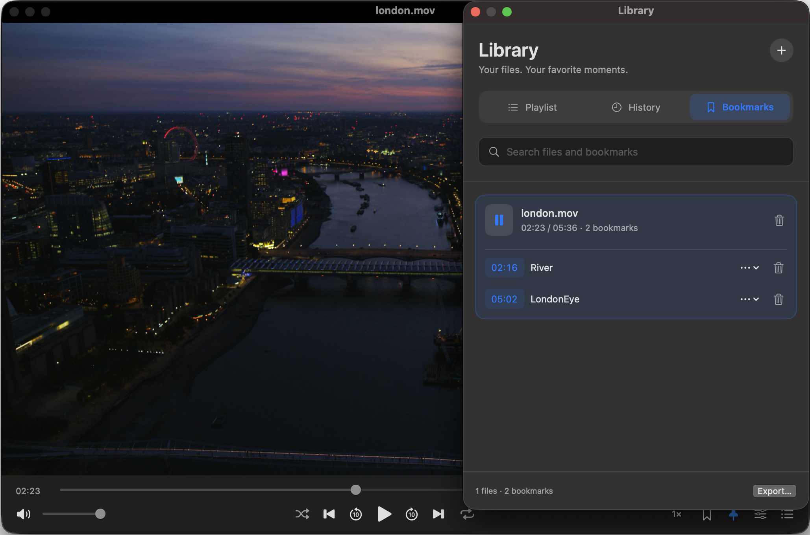

# Lola Player

A video and audio player for Mac. Save and name your favorite moments with bookmarks, find them across your files, and jump straight back to them. Keep the player on top while a video plays; it returns to normal when paused.

A Player with **named bookmarks at any video timestamp** and **Float on Top that follows playback**. 

> **Save a moment. Name it. Find it again.** Bookmark the selected time in any playable video and give the bookmark a meaningful name. Lola keeps bookmarks from all your videos in a separate, searchable **Bookmarks** list—even after you open another file or restart the app. Search by bookmark name or filename, then click a bookmark to reopen the video and start playback at the exact saved time.

**[Download Lola Player for Mac](https://github.com/mrkheradmand/LolaPlayer/releases/latest)** · Apple Silicon · macOS 27 or later

<p align="center">
  
</p>

## Install

1. Download the latest **.dmg** from the link above.
2. Open it and drag **Lola Player** to **Applications**.
3. Eject the disk image and open Lola Player from Applications.

The app isn't notarized, so macOS may block the first launch. Go to **System Settings → Privacy & Security → Open Anyway**, or run this command in Terminal after moving the app to Applications:

```sh
xattr -dr com.apple.quarantine "/Applications/Lola Player.app"
```

Installation instructions are also included in **Install Notes.txt** inside the disk image. No extra playback software is needed.

<p align="center">
  
</p>

The app uses a flat mint-green play icon on a charcoal tile.

## Features

Drag media files or folders onto **Library → Playlist** to add them without starting playback. Folders include media in all subfolders; existing playlist items are not duplicated. Drag a Playlist card over the upper or lower half of another card to choose the insertion line; drop below the last item to move it to the end. The order is remembered.

The menu and player window open before your library and playback engine finish loading.

- Named, searchable bookmarks that stay saved when you close the app.
- Float on Top during playback, full screen, and adjustable window sizes. **View → Remember Window Position and Size** restores your window when you reopen the app.
- Media-only view (**2**) fits the window to the video and progress bar without moving the media upward; **1** restores the previous window size and full interface. Your choice is remembered when you reopen the app. Right-click the player and choose **Close** to close it.
- Drag the player to move its window; click once to play/pause and twice for full screen.
- Hover or drag along the progress bar to see the time and a thumbnail for local video files. Cached previews appear immediately.
- A separate, resizable library window for playlists, history, and bookmarks. It opens beside the player when space allows and floats at the right-center in full screen.
- Playlists, playback history, shuffle, repeat, and A–B looping. With **Repeat Off**, playback stops at the end of the current file, even if Shuffle is on.
- Scroll up or down over the active video to raise or lower volume. A mouse wheel changes it in 5% steps; trackpad scrolling offers finer control.
- Playback speed from **0.25× to 4×**, frame stepping, and chapter navigation.
- Audio and subtitle selection, external subtitles, and timing adjustments.
- Mac media keys and Now Playing controls.
- Notifications when a new GitHub release is available.

## Supported file types

| Type | Formats |
| --- | --- |
| Video | MP4, MKV, MOV, AVI, WebM, M4V, WMV, FLV, MPEG/MPG, TS, 3GP/3G2, F4V, ASF, DIVX, M2TS/MTS/M2T, VOB/EVO, MXF, DV, Y4M, IVF, RM/RMVB, OGV/OGM, WTV, DAV, BIK/SMK, VVC/H266 |
| Audio | MP3, M4A, FLAC, WAV, OGG, Opus, AAC, MKA, OGA, WEBA, AIF/AIFF/AIFC, CAF, AU/SND, APE, WV, MPC, TTA, TAK, SHN, AMR, SPX, WMA, AC3/EAC3, DTS/DTSHD, THD/MLP, DSF/DFF, RA |
| MIDI | MID, MIDI (requires the Mac's built-in MIDI instrument) |
| Playlists | M3U, M3U8 |
| Subtitles | SRT, ASS, SSA, VTT, SUB (some SUB files need companion files) |
| Online media | Direct media links and compatible HTTP/HTTPS, RTSP, and RTMP streams |

Playback depends on the codecs used inside each file; not every variation has been tested. Live streams may not support seeking. Protected streaming services and video webpage links such as YouTube aren't supported.

Unencrypted Blu-ray folders and ISO images have limited support, without disc menus. DVD folders/images aren't supported by the current playback engine, but individual VOB files can play. Flash/SWF and tracker music files aren't supported.

## Quick controls

Open a file with **⌘O** or drag it onto the player. You can also open folders and playlists.

The compact bottom controls show the timeline and playback buttons; the filename is in the title bar and Library.

Click and hold on the media, then move the mouse to drag the window. A click without dragging plays or pauses and briefly shows a matching icon in the center, which fades away over one second (shorter with Reduce Motion). Hovering over the progress bar previews a moment without seeking. Dragging the playhead also shows previews and seeks when released. A nearby cached image may appear first, marked with its approximate time, while the precise frame loads.

| Action | Shortcut |
| --- | --- |
| Show full interface | 1 |
| Media only with progress bar | 2 |
| Play / pause | Space |
| Bookmark the current moment | ⌘B |
| Add a bookmark with a name | ⌥B |
| Reset playback speed to 1× | ⌘\ |
| Browse all bookmarks | ⇧⌘B |
| Toggle Float on Top | ⌥⌘T |

⌥B works only with the player focused, outside text fields, Settings, and dialogs.

Space plays/pauses only when Lola’s player window is active; it stays available to Finder for Quick Look when Finder is active. Dedicated Mac media keys still work separately.

Press **1** or **2** while the player window is active and you aren’t typing in a text box. Click the video to return keyboard control from Library or About.

Use the **Bookmarks** tab to name, search, and replay saved moments. The **Playlist** and **History** tabs help you return to your media. Click anywhere inside a tab button, including its padding, to switch lists. Open the library with **⌘L**, history with **⇧⌘H**, or bookmarks with **⇧⌘B**; the player keeps its current size.

Settings (**⌘,**) groups your preferences into **General**, **Playback**, and **Bookmarks**. Switches align along the right edge of each settings card. Changes apply immediately.

## Updates

Lola checks for new releases when it opens and once a day while running. When an update is available, click **View Release** in the notice to open the download page.

To turn automatic checks off, uncheck **Automatically check for updates** in **Lola Player → About Lola Player**. Use **Check for Updates…** in About to check manually at any time. **About Lola Player** also shows **Latest Version** or **New version available!** beside the version. Click the new-version message to open its release page. Updates are downloaded and installed manually. About closes when you return to the player or switch apps; open it again from the app menu.

## License

Lola Player’s original code and documentation are available under the [MIT License](LICENSE). Copyright © 2026 J Kheradmand. Bundled playback libraries retain their own licenses.

## Version

| App | Release |
| --- | --- |
| Version | 1.13.1, build 44 |


See [release notes](versions.md) for what's changed.
See [Technical README](README-technical.md) for advanced users.